<div align="center">


# Bazaaro

**Full-stack e-commerce platform with a storefront, customer accounts and an admin panel, built with ASP.NET Core Web API (.NET), SQL Server and a React SPA.**

[](https://dotnet.microsoft.com/) [](https://react.dev/) [](https://tailwindcss.com/) [](https://www.microsoft.com/sql-server) [](https://xunit.net/) [](https://vitest.dev/) [](https://ecommerce-platform-almaghrabyali.vercel.app) [](https://bazaaro.tryasp.net/api/health)

[Live Web App](https://ecommerce-platform-almaghrabyali.vercel.app) • [Live API](https://bazaaro.tryasp.net) • [API Health](https://bazaaro.tryasp.net/api/health) • [Backend Docs](backend/README.md) • [Frontend Docs](frontend/README.md)

</div>

---

## Overview

Bazaaro is a full-stack e-commerce platform featuring a modern public storefront, customer account management, and a comprehensive administration panel. Built for dependable online retail, all pricing, discounts, shipping rules, and line totals are strictly calculated on the server. Order placement executes within an atomic database transaction with point-in-time product snapshots and inventory decrements. Role-based JWT authentication and optimistic concurrency guards protect store data and customer isolation.

## Live Demo

- **Web App:** [ecommerce-platform-almaghrabyali.vercel.app](https://ecommerce-platform-almaghrabyali.vercel.app)
- **API Base URL:** [bazaaro.tryasp.net](https://bazaaro.tryasp.net) ([Health Endpoint](https://bazaaro.tryasp.net/api/health))
- **Admin Account:** `admin@shop.test` / `Admin@12345`
- **Customer Account:** `customer@shop.test` / `Customer@12345` (and demo customers with order history, e.g. `sara.hassan@shop.test` / `Demo@12345`)
- **Try it:** Browse and filter products, add to cart, checkout, then log in as admin and change the order status.

## Screenshots

| View | Screenshot | Description |
|---|---|---|
| Home | 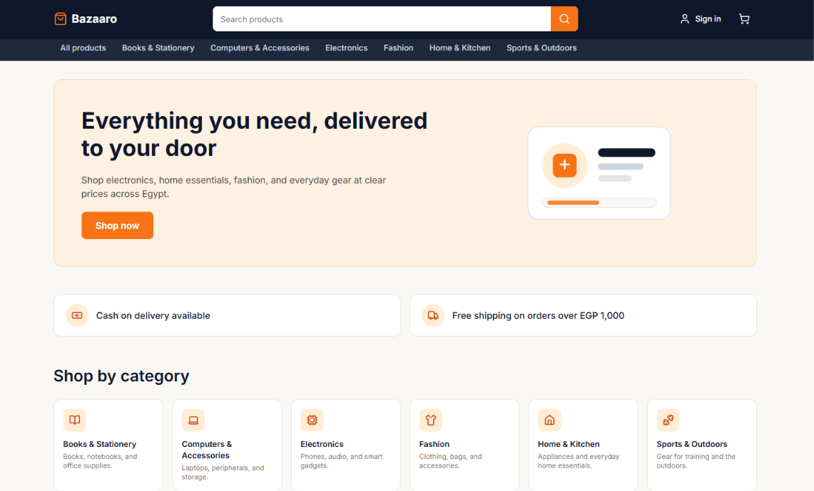 | Storefront hero, category list, and new arrivals |
| Shop | 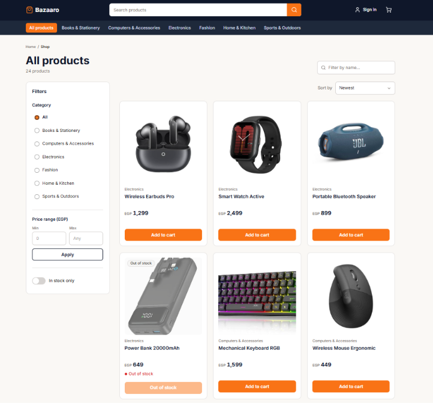 | Catalog with faceted search and sorting |
| Product | 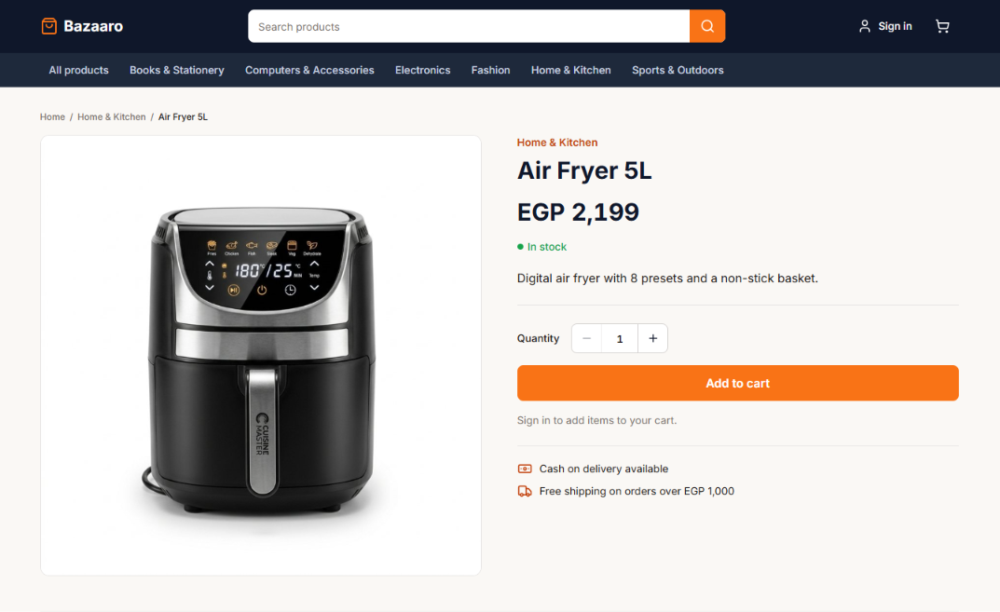 | Product details, stock status, and related items |
| Cart | 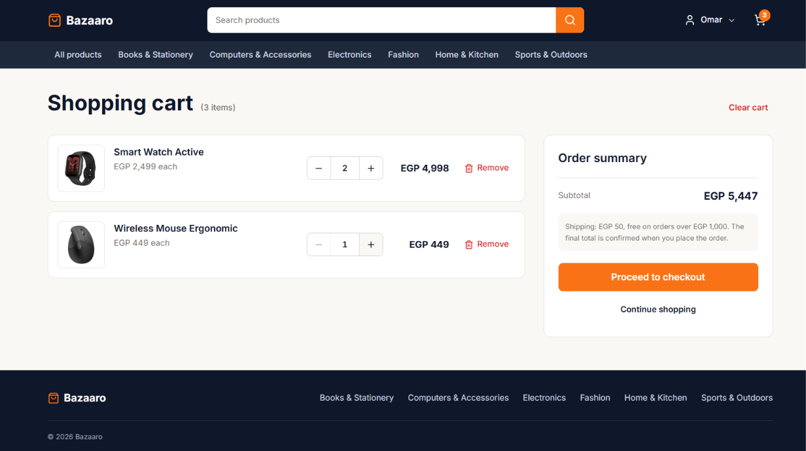 | Server-synced cart with quantity controls |
| Checkout | 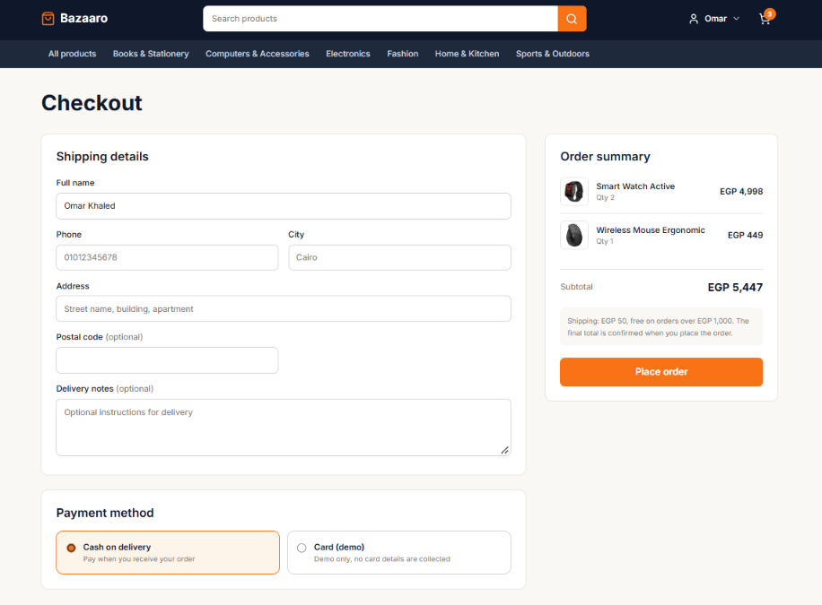 | Shipping details and payment method selection |
| Confirmation | 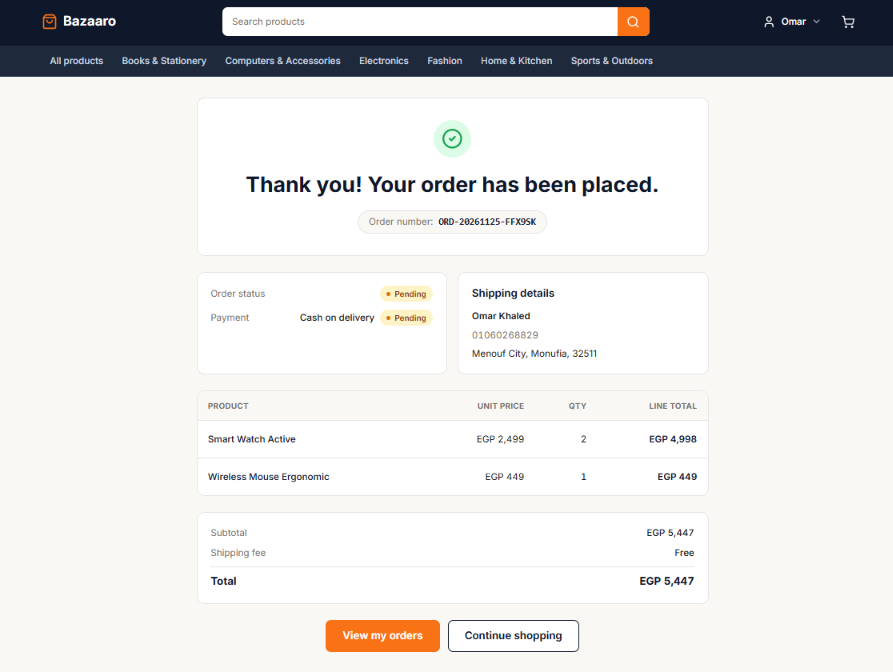 | Order summary and delivery status details |
| My Orders | 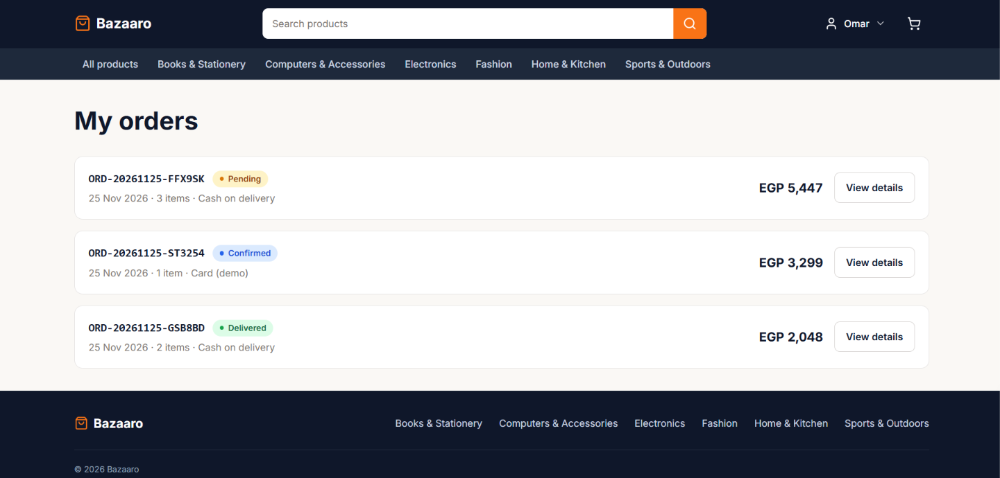 | Customer order history with cancellation support |
| Admin Dashboard | 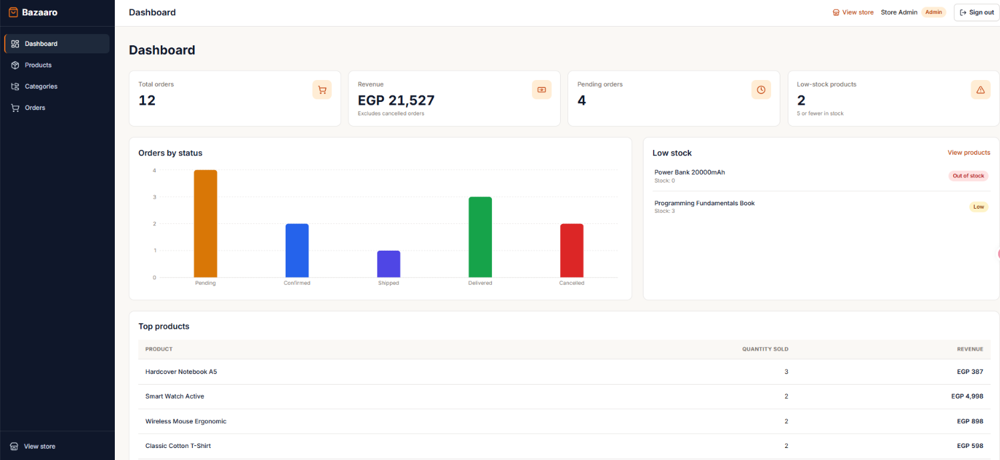 | Sales metrics, revenue charts, and stock warnings |
| Admin Products | 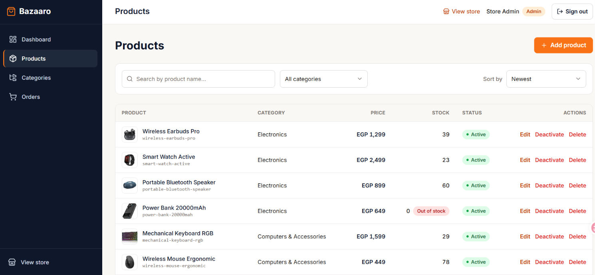 | Catalog table, image uploads, and deactivation |
| Admin Orders | 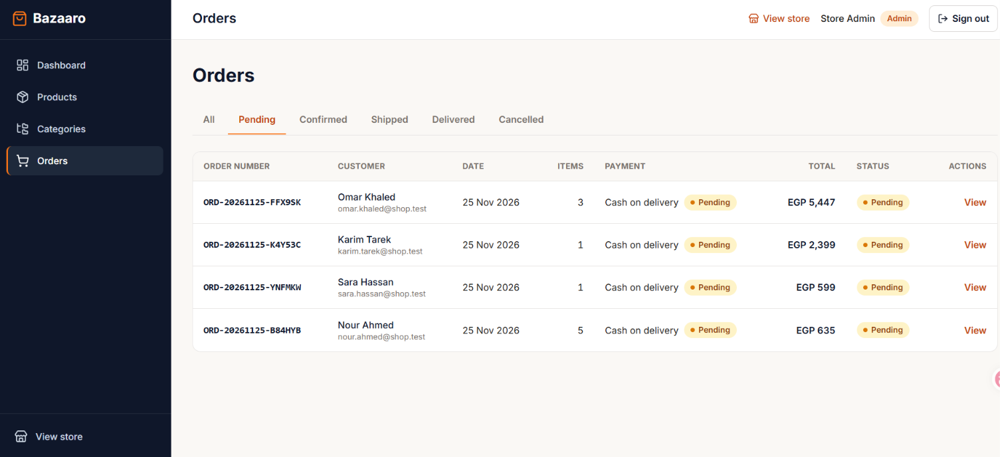 | Order management and status transition workflow |
| Swagger UI | 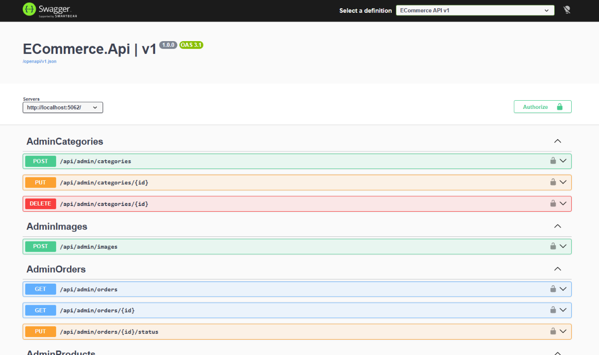 | Interactive OpenAPI documentation in local development |
| Mobile Home | 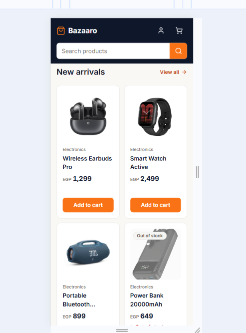 | Responsive mobile storefront and navigation drawer |
| Mobile Cart | 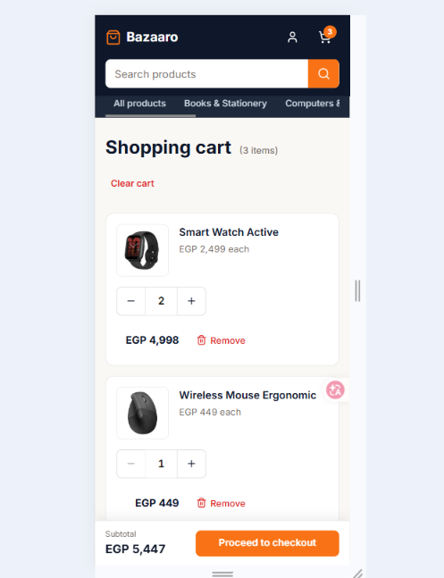 | Compact mobile shopping cart and checkout |

## Features

### Storefront
- Faceted catalog search and filtering by category, price bounds, in-stock state, and sorting.
- URL-synchronized search parameters for direct linking and browser history navigation.
- Dedicated product view with inventory status, category recommendations, and responsive layouts.

### Customer Area
- Server-synchronized shopping cart with real-time item count badges and stock clamping.
- Transactional checkout supporting Cash on Delivery and Mock Card with flat 50 EGP shipping (free at 1000 EGP).
- Order history tracking with item snapshots, progress stepper, and self-service cancellation on unfulfilled orders.

### Admin Panel
- Real-time business analytics dashboard with revenue charts, order status distribution, and low-stock alerts.
- Product catalog CRUD with optimistic concurrency (`RowVersion`), category assignment, and soft-delete protections.
- Sequential order fulfillment workflow (`Pending` -> `Confirmed` -> `Shipped` -> `Delivered`) and stock restoration on cancellation.

### Platform and Security
- Role-based authorization (`AdminOnly` policy and `Customer` role) enforced via JWT Bearer tokens.
- Strict RFC 7807 ProblemDetails structured error handling and BCrypt password hashing.
- Magic-byte image validation (JPEG, PNG, WebP up to 2 MB) with immutable client caching headers.

## Tech Stack

| Layer | Technologies | Purpose |
|---|---|---|
| Backend | ASP.NET Core 10, C# 13 | REST API controllers, business services, and security |
| Database | SQL Server, EF Core 10.0.14 | Relational data persistence, transactions, and migrations |
| Frontend | React 19.0.1, Vite 8.3.0 | Single-page application and responsive client UI |
| State & Styling | TanStack Query 5.107, Tailwind CSS 4.3.3 | Server-state caching, UI components, and modern styling |
| Testing | xUnit 2.9.3, Vitest 5.1.0, Testing Library | Integration testing, component tests, and accessibility |
| Hosting | Vercel, MonsterASP.NET | Edge CDN static hosting and IIS Windows cloud hosting |

## Architecture

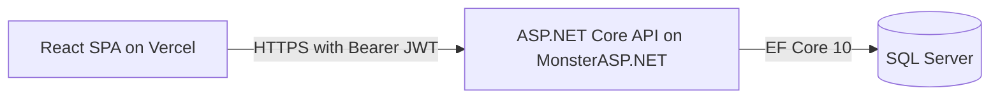

HTTP requests enter controller endpoints, which validate request models and delegate execution to domain services (`OrderService`, `CartService`, `ProductService`). Services communicate directly with SQL Server via EF Core `AppDbContext`, eliminating redundant repository layers. Public contracts are strictly separated into request and response DTOs, ensuring internal domain entities are never exposed. Unhandled domain exceptions are converted into RFC 7807 ProblemDetails responses by custom exception handling middleware.

## Project Structure

```text
├── backend/
│   ├── src/ECommerce.Api/       # Controllers, services, entities, DTOs, and migrations
│   └── tests/ECommerce.Tests/   # xUnit integration test suite with isolated database
├── frontend/
│   ├── public/                  # Static assets and SVG icons
│   └── src/                     # React components, pages, hooks, api layer, and tests
├── docs/screenshots/            # Captured desktop and mobile UI application views
└── scripts/                     # PowerShell automated seeding and E2E validation script
```

## Database Design

```mermaid
erDiagram
    Users ||--o| Carts : owns
    Users ||--o{ Orders : places
    Categories ||--o{ Products : categorizes
    Carts ||--o{ CartItems : contains
    Orders ||--o{ OrderItems : contains
    Users { int Id PK string Email UK string Role }
    Categories { int Id PK string Slug UK }
    Products { int Id PK string Slug UK decimal Price int StockQuantity bool IsActive binary RowVersion }
    Carts { int Id PK int UserId FK_UK }
    CartItems { int Id PK int CartId FK int ProductId FK int Quantity }
    Orders { int Id PK string OrderNumber UK int UserId FK string Status decimal Total }
    OrderItems { int Id PK int OrderId FK int ProductId FK decimal UnitPrice int Quantity }
    ProductImages { int Id PK string ContentType binary Data }
```

Indexes include unique constraints on `Users.Email`, `Categories.Slug`, `Products.Slug`, `Carts.UserId`, `CartItems(CartId, ProductId)`, and `Orders.OrderNumber`, alongside composite indexes on `Products(CategoryId, IsActive)` and `Orders(UserId, CreatedAt)`. Cascade deletion is configured for `Carts->Users`, `CartItems->Carts`, and `OrderItems->Orders`, while restrict deletion protects `Products->Categories`, `CartItems->Products`, `OrderItems->Products`, and `Orders->Users`.

## API Overview

| Group | Method & Route | Purpose |
|---|---|---|
| Public | `GET /api/health`, `/api/categories`, `/api/products[/{slug}]` | System health check and public catalog browsing |
| Public | `GET /api/images/{id}`, `POST /api/auth/{register,login}` | Image streaming and user authentication |
| Customer | `GET,POST,PUT,DELETE /api/cart[/{productId}]` | Shopping cart retrieval, mutation, and item removal |
| Customer | `GET,POST /api/orders[/{id},/{id}/cancel]` | Transactional checkout, order history, and cancellation |
| Admin | `GET,POST,PUT,DELETE /api/admin/{products,categories}[/{id}]` | Catalog product/category CRUD and concurrency management |
| Admin | `GET,PUT /api/admin/orders[/{id},/{id}/status]`, `GET /api/admin/stats` | Order fulfillment progression and business dashboard metrics |
| Admin | `POST /api/admin/images` | Binary product image upload (JPEG/PNG/WebP, max 2 MB) |

For complete request payloads, parameters, and response schemas, see [Backend Docs](backend/README.md).

## Running Locally

**Prerequisites:** .NET 10 SDK, Node.js >= 20, SQL Server LocalDB `(localdb)\MSSQLLocalDB`.

Backend:
```powershell
dotnet user-secrets set "Jwt:Key" "local-dev-jwt-secret-key-minimum-32-chars-long" --project backend/src/ECommerce.Api
dotnet user-secrets set "Seed:AdminEmail" "admin@shop.test" --project backend/src/ECommerce.Api ; dotnet user-secrets set "Seed:AdminPassword" "Admin@12345" --project backend/src/ECommerce.Api
dotnet user-secrets set "Seed:CustomerEmail" "customer@shop.test" --project backend/src/ECommerce.Api ; dotnet user-secrets set "Seed:CustomerPassword" "Customer@12345" --project backend/src/ECommerce.Api
dotnet ef database update --project backend/src/ECommerce.Api
dotnet run --project backend/src/ECommerce.Api --launch-profile "http"
```
The API runs at `http://localhost:5062` (Swagger UI: `http://localhost:5062/swagger`).

Frontend:
```powershell
cd frontend
npm install
Copy-Item .env.example .env
npm run dev
```
The application runs at `http://localhost:5173`.

## Configuration

| Setting | Variable Name | Secret | Purpose |
|---|---|:---:|---|
| `ConnectionStrings:DefaultConnection` | `ConnectionStrings__DefaultConnection` | Yes | SQL Server connection string |
| `Jwt:Key` | `Jwt__Key` | Yes | HMAC-SHA256 signing secret key (minimum 32 characters) |
| `Jwt:Issuer` / `Audience` | `Jwt__Issuer` / `Jwt__Audience` | No | JWT token validation parameters |
| `Shipping:FlatFee` / `FreeThreshold` | `Shipping__FlatFee` / `Shipping__FreeThreshold` | No | Flat fee (50 EGP) and free shipping threshold (1000 EGP) |
| `Cors:AllowedOrigins` | `Cors__AllowedOrigins__0`, `...__1` | No | Allowed frontend origins without trailing slashes |
| `Seed:*` | `Seed__Admin*`, `Seed__Customer*` | Yes | Default seed credentials for initial migrations |

For full configuration options, see [Backend Docs](backend/README.md).

## Testing & Quality

- **Backend:** 43 passed integration tests in xUnit validating authorization barriers, transactional checkout, stock restoration, and image validation.
- **Frontend:** 146 passed unit, component, and journey tests in Vitest across 34 test files, accompanied by zero ESLint warnings.
- **End-to-End API Verification:** The `scripts/demo-seed.ps1` script seeds demo data and verifies the entire shop through the live API (filters, validation, role access, checkout totals, status flow, cancellations with stock restore, concurrency, dashboard numbers). In its last run against the live API, all 192 checks passed with 0 failures. The script supports 5 modes (`Prepare`, `Local`, `Images`, `Shop`, `All`) for image acquisition and functional verification.

## Deployment

- **Frontend (Vercel):** Single-page application built with Vite (`npm run build`), published from `dist` with `vercel.json` SPA rewrites and `VITE_API_URL=https://bazaaro.tryasp.net/api`.
- **Backend (MonsterASP.NET):** Windows Server/IIS with in-process .NET 10 hosting and SQL Server, deployed via Web Deploy with automated Let's Encrypt SSL/TLS.
- **Production Variables:** Configured in host settings: `ASPNETCORE_ENVIRONMENT=Production`, `ConnectionStrings__DefaultConnection`, `Jwt__Key`, `Seed__*`, and `Cors__AllowedOrigins__1`.
- **Database Migrations:** Applied manually using `dotnet ef database update --connection "<connection-string>" --project backend/src/ECommerce.Api`.
- **Pitfalls:** HTTP 500.30 occurs if `Jwt__Key` or database connection is misconfigured at startup; CORS requires exact origin match without trailing slashes; HTTPS frontend requires an HTTPS API endpoint.

## Limitations & Roadmap

- Payments are simulated without third-party payment gateway integration (e.g. Stripe, Paymob).
- Transactional email dispatch (order receipts, password resets) is not wired up.
- JWT tokens expire after 60 minutes with no refresh token rotation mechanism.
- Product images are stored directly in SQL Server as binary blobs rather than external cloud object storage.
- Free-tier hosting worker processes idle after inactivity, resulting in cold-start latency.
- Request rate limiting and throttling middleware are not yet implemented.

## Note

Product photos are sample images used for demonstration only.

## Author

Almaghraby Ali — [GitHub](https://github.com/AlmaghrabyAli)
