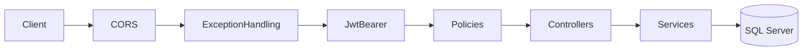

<div align="center">


# Bazaaro API

**ASP.NET Core Web API on .NET powering a full e-commerce platform with SQL Server persistence, JWT roles and transactional checkout.**

[](https://dotnet.microsoft.com/) [](https://dotnet.microsoft.com/apps/aspnet/apis) [](https://learn.microsoft.com/ef/core/) [](https://www.microsoft.com/sql-server) [-000000?style=flat&logo=jsonwebtokens&logoColor=white)](https://jwt.io/) [](https://xunit.net/) [](https://bazaaro.tryasp.net/api/health)

[Live API](https://bazaaro.tryasp.net) • [Health Check](https://bazaaro.tryasp.net/api/health) • [Live App](https://ecommerce-platform-almaghrabyali.vercel.app) • [Project README](../README.md) • [Frontend Docs](../frontend/README.md) • Demo: `admin@shop.test` / `Admin@12345`

</div>

---

The live API is served at `https://bazaaro.tryasp.net` with health telemetry at `/api/health`; Swagger UI is enabled exclusively in `Development` at `http://localhost:5062/swagger`.

## Overview & Key Design Decisions

- **Layered Architecture:** Controllers handle HTTP mapping and model binding, delegating all domain logic to scoped services (`OrderService`, `CartService`, etc.).
- **No Repository Layer:** Directly consumes EF Core `AppDbContext` and `DbSet<T>` in domain services, utilizing native change tracking without redundant abstractions.
- **DTO Separation:** Strict contract boundary separating public request/response DTOs from internal entities; domain entities are never exposed.
- **ProblemDetails Error Model:** `ExceptionHandlingMiddleware` maps domain exceptions (`NotFoundException`, `ConflictException`, `BadRequestException`) to RFC 7807 responses.
- **Transactional Checkout:** Atomic checkout executes in an explicit database transaction to validate active stock, snapshot prices/names and shipping, decrement inventory, and clear the cart.
- **Optimistic Concurrency:** `Product.RowVersion` uses SQL Server rowversion byte tokens to prevent lost updates during concurrent edits (returning 409).
- **Server-Side Pricing:** All line totals, flat shipping fees (50 EGP), and free shipping thresholds (1000 EGP) are computed on the server from current database prices.
- **Role-Based Authorization & Ownership:** `AdminOnly` policy gates admin routes; customer endpoints derive user identity strictly from the validated JWT `sub` claim.
- **Product Soft Delete:** Products linked to existing orders cannot be deleted (returns 409) and must be deactivated via `isActive: false` to preserve order history.
- **Media Persistence:** Product images are stored directly in SQL Server as `varbinary(max)` with magic-byte format validation and immutable HTTP caching.

## Tech Stack

- **Runtime & Framework:** .NET 10 (`net10.0`), ASP.NET Core Web API with controllers.
- **Data & ORM:** SQL Server with Entity Framework Core 10.0.14 (code-first migrations, connection resiliency).
- **Security & Identity:** JWT Bearer (HS256) via `Microsoft.AspNetCore.Authentication.JwtBearer` 10.0.14 and BCrypt hashing via `BCrypt.Net-Next` 4.2.0.
- **API Documentation:** Built-in OpenAPI document generation (`Microsoft.AspNetCore.OpenApi` 10.0.11) and Swashbuckle Swagger UI 10.3.1.
- **Testing:** xUnit 2.9.3, `Microsoft.AspNetCore.Mvc.Testing` 10.0.15 (in-memory TestServer), and Coverlet collector 6.0.4.
- **Hosting:** MonsterASP.NET (Windows Server, IIS in-process hosting, Let's Encrypt SSL/TLS).

## Architecture


- `src/ECommerce.Api/`: Controllers, DTOs, Entities, Domain Services, Data/Migrations, Security, and Middleware.
- `tests/ECommerce.Tests/`: Integration tests running against isolated test databases.

## Data Model

```mermaid
erDiagram
    Users ||--o| Carts : has
    Users ||--o{ Orders : places
    Categories ||--o{ Products : contains
    Carts ||--o{ CartItems : contains
    Orders ||--o{ OrderItems : contains
    Users { int Id PK string Email UK string Role }
    Categories { int Id PK string Slug UK }
    Products { int Id PK string Slug UK decimal Price int StockQuantity bool IsActive binary RowVersion }
    Carts { int Id PK int UserId FK_UK }
    CartItems { int Id PK int CartId FK int ProductId FK int Quantity }
    Orders { int Id PK string OrderNumber UK int UserId FK string Status decimal Total }
    OrderItems { int Id PK int OrderId FK int ProductId FK decimal UnitPrice int Quantity }
    ProductImages { int Id PK string ContentType int SizeBytes binary Data }
```
- **Indexes:** Unique on `Users.Email`, `Categories.Slug`, `Products.Slug`, `Carts.UserId`, `CartItems(CartId, ProductId)`, `Orders.OrderNumber`; composite on `Products(CategoryId, IsActive)` and `Orders(UserId, CreatedAt)`.
- **Delete Behaviors:** Cascade delete on `Carts->Users`, `CartItems->Carts`, and `OrderItems->Orders`; Restrict delete on `Products->Categories`, `CartItems->Products`, `OrderItems->Products`, and `Orders->Users`.
- **RowVersion & Snapshots:** `Product.RowVersion` handles optimistic concurrency; `OrderItem` permanently snapshots `ProductName` and `UnitPrice` at checkout, while `Order` snapshots recipient shipping details.

## API Reference

| Method | Route | Auth | Purpose |
|---|---|---|---|
| `GET` | `/api/health` | Public | System health status and current UTC timestamp |
| `GET` | `/api/categories` | Public | List all product categories |
| `GET` | `/api/products` | Public | Search, filter, and paginate active catalog products |
| `GET` | `/api/products/{slug}` | Public | Retrieve active product details by URL slug |
| `GET` | `/api/images/{id}` | Public | Stream binary image with 1-year immutable cache header |
| `POST` | `/api/auth/register` | Public | Register a new customer account and return JWT |
| `POST` | `/api/auth/login` | Public | Authenticate user credentials and return JWT |
| `GET` | `/api/auth/me` | Customer / Admin | Get profile of the current authenticated user |
| `GET` | `/api/cart` | Customer | Retrieve customer cart with computed line totals |
| `POST` | `/api/cart/items` | Customer | Add product to cart or increment existing quantity |
| `PUT` | `/api/cart/items/{productId}` | Customer | Update item quantity in cart (range 1-1000) |
| `DELETE` | `/api/cart/items/{productId}` | Customer | Remove specific product from cart |
| `DELETE` | `/api/cart` | Customer | Clear all items from customer cart |
| `POST` | `/api/orders` | Customer | Checkout active cart inside an ACID transaction |
| `GET` | `/api/orders` | Customer | List order history for the authenticated customer |
| `GET` | `/api/orders/{id}` | Customer | Retrieve order details and snapshot line items |
| `POST` | `/api/orders/{id}/cancel` | Customer | Cancel pending or confirmed order and restore stock |
| `GET` | `/api/admin/products` | AdminOnly | List all products including inactive items |
| `GET` | `/api/admin/products/{id}` | AdminOnly | Retrieve product by ID for administrative editing |
| `POST` | `/api/admin/products` | AdminOnly | Create new product with auto-generated slug |
| `PUT` | `/api/admin/products/{id}` | AdminOnly | Update product requiring Base64 `RowVersion` |
| `DELETE` | `/api/admin/products/{id}` | AdminOnly | Delete un-ordered product (soft-delete required if ordered) |
| `POST` | `/api/admin/categories` | AdminOnly | Create new product category |
| `PUT` | `/api/admin/categories/{id}` | AdminOnly | Update category name and description |
| `DELETE` | `/api/admin/categories/{id}` | AdminOnly | Delete category (rejected if products are assigned) |
| `GET` | `/api/admin/orders` | AdminOnly | List paginated store orders with status filter |
| `GET` | `/api/admin/orders/{id}` | AdminOnly | Get complete order record with customer contact info |
| `PUT` | `/api/admin/orders/{id}/status` | AdminOnly | Advance order status or cancel and restore stock |
| `GET` | `/api/admin/stats` | AdminOnly | Get dashboard analytics, revenue, and inventory metrics |
| `POST` | `/api/admin/images` | AdminOnly | Upload product image file (JPEG/PNG/WebP, max 2 MB) |

Status codes: `400` (Validation or invalid transition), `401` (Unauthenticated), `403` (Forbidden / non-admin), `404` (Resource not found or unauthorized), `409` (Conflict / duplicate key / concurrency collision).

## Business Rules

- **Server-Calculated Totals:** Quantities must be 1-1000 and within stock limits; inactive products cannot be carted or checked out; all totals recalculate from current DB prices.
- **Checkout Transaction:** Single ACID transaction that validates stock, creates point-in-time order/item snapshots, decrements inventory, and empties the cart (returns 409 on concurrency conflicts).
- **Shipping Fee:** 50 EGP flat shipping fee; orders with item subtotal >= 1000 EGP automatically receive free shipping.
- **Simulated Payments:** `CashOnDelivery` (marked `Pending`, updated to `Paid` on delivery) and `MockCard` (marked `Paid` at checkout); no card data is stored.
- **Status Flow & Cancellation:** Permitted transitions are `Pending` -> `Confirmed` -> `Shipped` -> `Delivered`. Orders can only be cancelled from `Pending` or `Confirmed`, which restores inventory.
- **Image Upload Rules:** Multipart `file` upload, max 2 MB (10 MB request limit), magic-byte detection (JPEG, PNG, WebP), stored as `varbinary(max)`, served with `ETag` and immutable 1-year cache.

## Configuration

| Key | Environment Variable | Secret | Purpose |
|---|---|:---:|---|
| `ConnectionStrings:DefaultConnection` | `ConnectionStrings__DefaultConnection` | Yes | SQL Server connection string |
| `Jwt:Key` | `Jwt__Key` | Yes | HMAC-SHA256 signing secret key (minimum 32 characters) |
| `Jwt:Issuer` / `Audience` / `ExpiryMinutes` | `Jwt__Issuer` / `Audience` / `ExpiryMinutes` | No | JWT token validation parameters (lifetime: 60 minutes) |
| `Shipping:FlatFee` / `FreeThreshold` | `Shipping__FlatFee` / `FreeThreshold` | No | Shipping fee rules (default: 50 EGP flat, free at 1000 EGP) |
| `Cors:AllowedOrigins` | `Cors__AllowedOrigins__0`, `...__1` | No | Permitted CORS frontend origins without trailing slash |
| `Seed:AdminEmail` / `Password` | `Seed__AdminEmail` / `AdminPassword` | Yes | Initial administrator credentials for automated seeding |
| `Seed:CustomerEmail` / `Password` | `Seed__CustomerEmail` / `CustomerPassword` | Yes | Initial customer credentials for automated seeding |

## Running Locally

**Prerequisites:** .NET 10 SDK and SQL Server LocalDB `(localdb)\MSSQLLocalDB`.

```powershell
dotnet user-secrets set "Jwt:Key" "local-dev-jwt-secret-key-minimum-32-chars-long" --project src/ECommerce.Api
dotnet user-secrets set "Seed:AdminEmail" "admin@shop.test" --project src/ECommerce.Api ; dotnet user-secrets set "Seed:AdminPassword" "Admin@12345" --project src/ECommerce.Api
dotnet user-secrets set "Seed:CustomerEmail" "customer@shop.test" --project src/ECommerce.Api ; dotnet user-secrets set "Seed:CustomerPassword" "Customer@12345" --project src/ECommerce.Api
dotnet ef database update --project src/ECommerce.Api
dotnet run --project src/ECommerce.Api --launch-profile "http"
```

On startup, `DbSeeder` applies pending EF Core migrations and seeds initial accounts; `CatalogSeeder` idempotently seeds 6 categories and 24 products by slug. Access Swagger UI at `http://localhost:5062/swagger`.

## Testing

Run tests with `dotnet test tests/ECommerce.Tests/ECommerce.Tests.csproj`. 43 passed integration tests verify admin authorization barriers, transactional checkout logic, customer ownership boundaries, stock decrement/restoration, and magic-byte image detection.
The repository root test script [../scripts/demo-seed.ps1](../scripts/demo-seed.ps1) verifies live system behavior with 192 automated checks and 0 failures.

## Deployment

- **Host:** MonsterASP.NET free tier running Windows Server / IIS 10 with .NET 10 in-process hosting and SQL Server.
- **Web Deploy:** Deployed directly from Visual Studio MSDeploy using `site110104-WebDeploy.pubxml` (git-ignored).
- **HTTPS:** Secured with automated Let's Encrypt SSL/TLS certificates.
- **Production Variables:** `ASPNETCORE_ENVIRONMENT=Production`, `ConnectionStrings__DefaultConnection`, `Jwt__Key`, `Seed__*`, and `Cors__AllowedOrigins__1`.
- **Manual Migrations:** Applied from workstation via `dotnet ef database update --connection "<public-connection-string>" --project src/ECommerce.Api`.

Pitfalls: HTTP 500.30 occurs if `Jwt__Key` or database connection is invalid because seeding runs at startup; CORS requires exact origin match without trailing slash; internal SQL host only resolves on the server.

## Limitations & Roadmap

- **Payment Gateway:** Payments are simulated without third-party processing integrations (e.g., Stripe, Paymob).
- **Email Notifications:** No SMTP provider is wired up for transactional order receipts or account recovery.
- **Token Refresh:** JWTs expire after 60 minutes with no refresh token rotation mechanism.
- **Media Storage:** Images reside as `varbinary(max)` in SQL Server rather than dedicated object storage (S3/R2).
- **Free Tier Cold Starts:** Free-tier IIS worker processes idle out, introducing latency on cold requests.
- **Rate Limiting:** No rate limiting or request throttling middleware is currently active.

## Author

Almaghraby Ali — [GitHub](https://github.com/AlmaghrabyAli)
