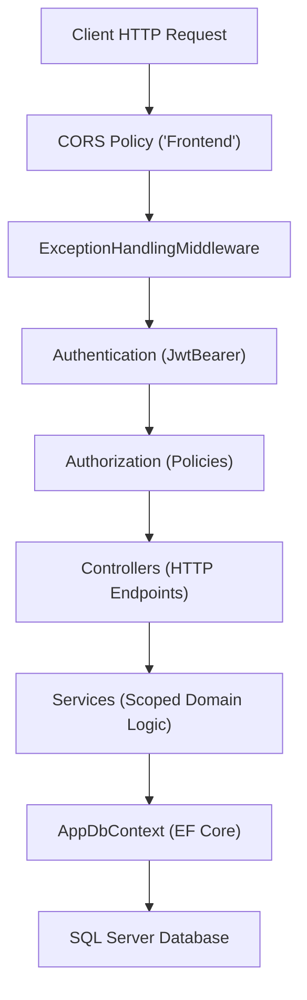
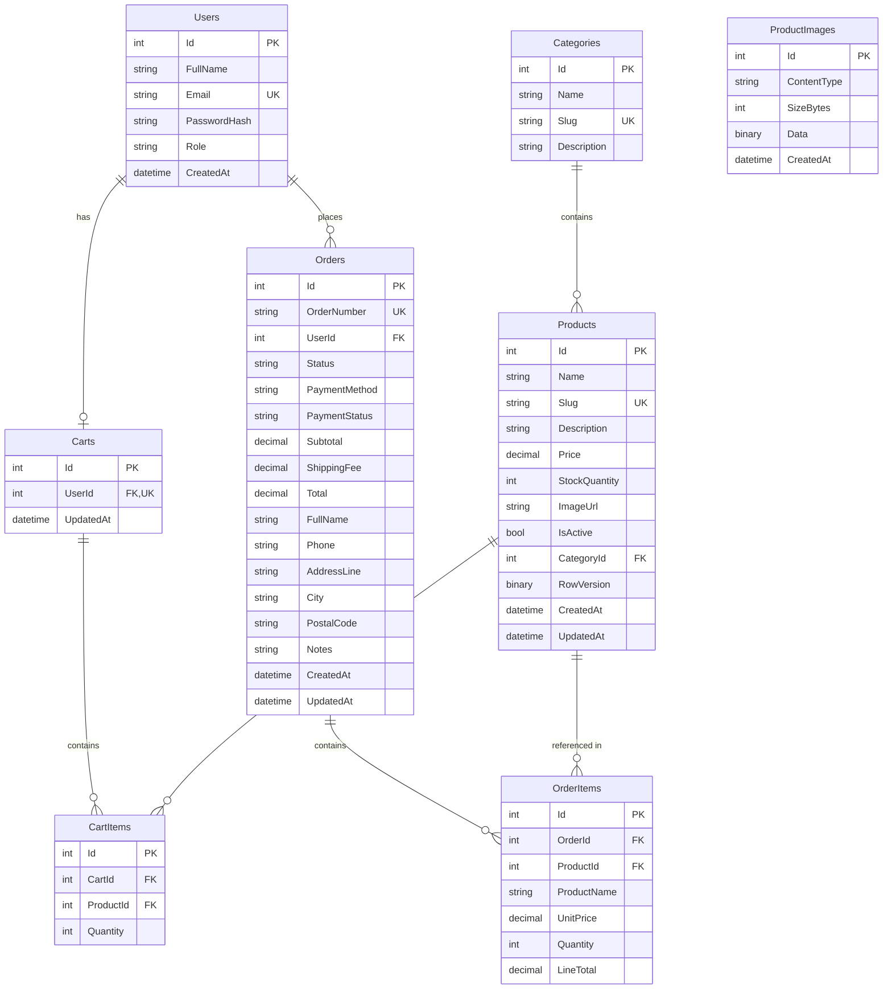
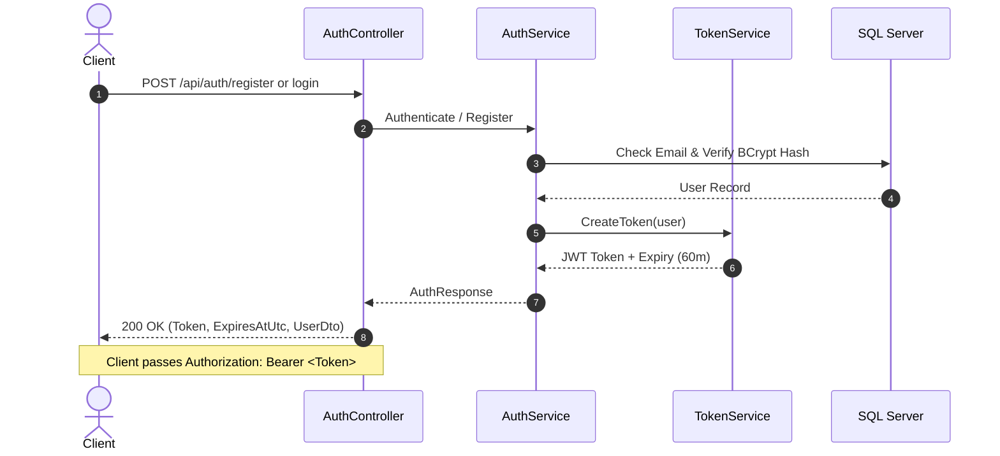

# Bazaaro API

A modular, production-ready ASP.NET Core 10 Web API powering the Bazaaro e-commerce platform with catalog management, shopping cart operations, transactional checkout, simulated payments, and role-based administrative workflows.


- Live API: [https://bazaaro.tryasp.net](https://bazaaro.tryasp.net)
- API Health Check: [https://bazaaro.tryasp.net/api/health](https://bazaaro.tryasp.net/api/health)
- Live Web Application: [https://ecommerce-platform-almaghrabyali.vercel.app](https://ecommerce-platform-almaghrabyali.vercel.app)
- Repository Root Documentation: [../README.md](../README.md)
- Frontend Documentation: [../frontend/README.md](../frontend/README.md)

---

## Overview

Bazaaro API is the backend service for the Bazaaro e-commerce ecosystem. Built with C# and ASP.NET Core on .NET 10, it exposes a RESTful interface consumed by storefront and administration frontends.

### Key Responsibilities

- **Product Catalog**: Multi-criteria catalog queries with searching, category filtering, price ranges, in-stock filtering, and dynamic sorting by price, name, or creation date.
- **Identity and Access Control**: JWT Bearer authentication, salted password hashing via BCrypt, and policy-based authorization (`AdminOnly`).
- **Shopping Cart**: Persistent, server-managed carts per customer with stock availability checks and real-time total recalculations.
- **Transactional Checkout**: ACID database transactions executing stock reservation, snapshot captures of product pricing and recipient shipping details, and shopping cart clearance.
- **Order Lifecycle**: Order status progression (`Pending` -> `Confirmed` -> `Shipped` -> `Delivered`), order cancellation with automatic stock restoration, and simulated payment methods (`CashOnDelivery`, `MockCard`).
- **Administration**: Category and product management with optimistic concurrency control, binary image storage, and aggregate store analytics.
- **Media Storage**: Binary product image upload handling with magic byte validation, SQL Server binary persistence, and HTTP caching.

---

## Live API and Demo Accounts

The production API is hosted on MonsterASP.NET with Let's Encrypt SSL/TLS encryption.

- **Base URL**: `https://bazaaro.tryasp.net`
- **Health Endpoint**: `https://bazaaro.tryasp.net/api/health`

### Public Demo Accounts

| Role | Email | Password | Access Scope |
|------|-------|----------|--------------|
| Store Administrator | `admin@shop.test` | `Admin@12345` | Full administrative access across catalog, orders, categories, images, and analytics |
| Demo Customer | `customer@shop.test` | `Customer@12345` | Storefront browsing, cart management, checkout, and personal order tracking |

Additional demo customer accounts (such as `sara.hassan@shop.test` with password `Demo@12345`) can be provisioned using the repository root seed script located at [../scripts/demo-seed.ps1](../scripts/demo-seed.ps1).

> [!NOTE]
> Swagger UI (`/swagger`) and the OpenAPI v1 specification (`/openapi/v1.json`) are configured in `Program.cs` to run exclusively in the `Development` environment. In the `Production` environment, Swagger UI is disabled for performance and security hardening.

---

## Tech Stack

All packages and frameworks are verified directly from `src/ECommerce.Api/ECommerce.Api.csproj` and `tests/ECommerce.Tests/ECommerce.Tests.csproj`:

| Layer / Role | Technology | Version | Purpose |
|--------------|------------|---------|---------|
| Target Framework | .NET | 10.0 (`net10.0`) | Primary application runtime and SDK |
| Web API Framework | ASP.NET Core | 10.0.14 | Controller-based HTTP API framework |
| Object-Relational Mapper | Entity Framework Core | 10.0.14 | Code-first data access and LINQ queries |
| Database Provider | Microsoft.EntityFrameworkCore.SqlServer | 10.0.14 | SQL Server relational database driver |
| Database Tooling | Microsoft.EntityFrameworkCore.Design | 10.0.14 | EF Core migrations and schema management |
| Authentication | Microsoft.AspNetCore.Authentication.JwtBearer | 10.0.14 | Token authentication and Bearer validation |
| Password Hashing | BCrypt.Net-Next | 4.2.0 | Salted password hashing implementation |
| OpenAPI Specification | Microsoft.AspNetCore.OpenApi | 10.0.11 | Compile-time and runtime OpenAPI document generation |
| API Explorer UI | Swashbuckle.AspNetCore.SwaggerUI | 10.3.1 | Swagger UI interface for interactive API testing |
| Cryptography Support | System.Security.Cryptography.Pkcs | 10.0.13 | Cryptographic standards library |
| Test Framework | xUnit | 2.9.3 | Unit and integration test execution framework |
| Test Runner | xunit.runner.visualstudio | 3.1.4 | Visual Studio and CLI test execution adapter |
| Integration Testing | Microsoft.AspNetCore.Mvc.Testing | 10.0.15 | In-memory `WebApplicationFactory` test server |
| Test SDK | Microsoft.NET.Test.Sdk | 17.14.1 | MSBuild test infrastructure |
| Code Coverage | coverlet.collector | 6.0.4 | Code coverage data collection |

---

## Architecture and Design

### Request Processing Pipeline

Incoming HTTP requests flow through a configured ASP.NET Core middleware pipeline before hitting business services and the database:



### Layering Rules

1. **Controllers (`src/ECommerce.Api/Controllers/`)**:
   - Thin controllers handling HTTP protocol mapping, query string extraction, request body binding, and model validation.
   - Extract identity claims using helper extensions (`User.GetUserId()`).
   - Return strongly typed `ActionResult<T>` or `IActionResult`.
2. **Services (`src/ECommerce.Api/Services/`)**:
   - Registered with scoped lifetime (`AddScoped<TInterface, TImplementation>()`).
   - Contain business rules, stock validation, checkout transactions, price snapshot calculations, slug generation, and DTO mapping.
   - Enforce optimistic concurrency rules and boundary validations, throwing domain exceptions (`NotFoundException`, `ConflictException`, `BadRequestException`).
3. **Data Access (`src/ECommerce.Api/Data/`)**:
   - Uses `AppDbContext` directly inside services without redundant repository wrappers.
   - Leverages EF Core change tracking, compiled LINQ queries, and explicit database transactions (`BeginTransactionAsync`).
4. **DTO Strategy (`src/ECommerce.Api/Dtos/`)**:
   - Domain entities (`src/ECommerce.Api/Entities/`) are never exposed directly via controllers.
   - Dedicated request DTOs enforce validation attributes (`[Required]`, `[Range]`, `[StringLength]`, `[EnumDataType]`).
   - Dedicated response DTOs prevent data over-exposure and decouple client contracts from database table schemas.

### Folder Structure

```
backend/
├── ECommerce.sln
├── src/
│   └── ECommerce.Api/
│       ├── Controllers/
│       │   ├── AdminCategoriesController.cs
│       │   ├── AdminImagesController.cs
│       │   ├── AdminOrdersController.cs
│       │   ├── AdminProductsController.cs
│       │   ├── AdminStatsController.cs
│       │   ├── AuthController.cs
│       │   ├── CartController.cs
│       │   ├── CategoriesController.cs
│       │   ├── HealthController.cs
│       │   ├── ImagesController.cs
│       │   ├── OrdersController.cs
│       │   └── ProductsController.cs
│       ├── Data/
│       │   ├── Migrations/
│       │   │   ├── 20261105141218_InitialCreate.cs
│       │   │   ├── 20261105141218_InitialCreate.Designer.cs
│       │   │   ├── 20261114211237_AddProductImages.cs
│       │   │   ├── 20261114211237_AddProductImages.Designer.cs
│       │   │   └── AppDbContextModelSnapshot.cs
│       │   ├── AppDbContext.cs
│       │   ├── CatalogSeeder.cs
│       │   └── DbSeeder.cs
│       ├── Dtos/
│       │   ├── AdminOrderDtos.cs
│       │   ├── AdminStatsDtos.cs
│       │   ├── AuthDtos.cs
│       │   ├── CartDtos.cs
│       │   ├── CategoryDtos.cs
│       │   ├── ImageDtos.cs
│       │   ├── OrderDtos.cs
│       │   ├── PagedResult.cs
│       │   └── ProductDtos.cs
│       ├── Entities/
│       │   ├── Cart.cs
│       │   ├── CartItem.cs
│       │   ├── Category.cs
│       │   ├── Order.cs
│       │   ├── OrderEnums.cs
│       │   ├── OrderItem.cs
│       │   ├── Product.cs
│       │   ├── ProductImage.cs
│       │   ├── Roles.cs
│       │   └── User.cs
│       ├── Exceptions/
│       │   └── AppExceptions.cs
│       ├── Helpers/
│       │   └── SlugHelper.cs
│       ├── Middleware/
│       │   └── ExceptionHandlingMiddleware.cs
│       ├── Properties/
│       │   ├── PublishProfiles/
│       │   │   ├── .gitignore
│       │   │   └── site110104-WebDeploy.pubxml
│       │   └── launchSettings.json
│       ├── Security/
│       │   ├── ClaimsPrincipalExtensions.cs
│       │   └── Policies.cs
│       ├── Services/
│       │   ├── AdminOrderService.cs
│       │   ├── AuthService.cs
│       │   ├── CartService.cs
│       │   ├── CategoryService.cs
│       │   ├── ImageService.cs
│       │   ├── OrderService.cs
│       │   ├── ProductService.cs
│       │   ├── StatsService.cs
│       │   └── TokenService.cs
│       ├── Swagger/
│       │   └── BearerSecurityTransformer.cs
│       ├── appsettings.Development.json
│       ├── appsettings.json
│       ├── ECommerce.Api.csproj
│       └── Program.cs
└── tests/
    └── ECommerce.Tests/
        ├── AdminAuthorizationTests.cs
        ├── ApiFixture.cs
        ├── AssemblyInfo.cs
        ├── ECommerce.Tests.csproj
        ├── OrderCancelAndAccessTests.cs
        ├── OrderCheckoutTests.cs
        ├── ProductDeleteTests.cs
        ├── ProductImageTests.cs
        └── TestDbFixture.cs
```

### Error Model

All exceptions and validation errors are formatted in compliance with RFC 7807 `ProblemDetails` (`application/problem+json`). `ExceptionHandlingMiddleware` intercepts uncaught domain exceptions and maps them to HTTP status codes:

- `NotFoundException` -> `404 Not Found` (title: `"Resource not found."`)
- `ConflictException` -> `409 Conflict` (title: `"Conflict."`)
- `BadRequestException` -> `400 Bad Request` (title: `"Bad request."`)
- Any other unhandled exception -> `500 Internal Server Error` (title: `"An unexpected error occurred."`). The detailed exception message is exposed only in `Development`; outside `Development`, the detail field is `null` to avoid information leakage.

#### Sample ProblemDetails Response

```json
{
  "type": "about:blank",
  "title": "Resource not found.",
  "status": 404,
  "detail": "Product not found.",
  "instance": "/api/products/unknown-item"
}
```

### Enum Serialization

Enums (`OrderStatus`, `PaymentMethod`, `PaymentStatus`) are serialized across the API and database as strings:

1. **HTTP JSON**: `Program.cs` registers `JsonStringEnumConverter`:
   ```csharp
   builder.Services.AddControllers()
       .AddJsonOptions(o => o.JsonSerializerOptions.Converters.Add(new JsonStringEnumConverter()));
   ```
2. **Database Schema**: `AppDbContext.cs` configures string conversions:
   ```csharp
   e.Property(x => x.Status).HasConversion<string>().HasMaxLength(20);
   e.Property(x => x.PaymentMethod).HasConversion<string>().HasMaxLength(20);
   e.Property(x => x.PaymentStatus).HasConversion<string>().HasMaxLength(20);
   ```

---

## Data Model

### Entity-Relationship Diagram



### Indexes and Referential Delete Actions

| Principal Table | Dependent Table | Foreign Key Column | Delete Action | Index Definition |
|-----------------|-----------------|--------------------|---------------|------------------|
| N/A | `Users` | N/A | N/A | `IX_Users_Email` (`Email` Unique) |
| N/A | `Categories` | N/A | N/A | `IX_Categories_Slug` (`Slug` Unique) |
| `Categories` | `Products` | `CategoryId` | `Restrict` | `IX_Products_Slug` (`Slug` Unique)<br>`IX_Products_CategoryId_IsActive` (`CategoryId`, `IsActive`) |
| `Users` | `Carts` | `UserId` | `Cascade` | `IX_Carts_UserId` (`UserId` Unique, 1:1) |
| `Carts` | `CartItems` | `CartId` | `Cascade` | `IX_CartItems_CartId_ProductId` (`CartId`, `ProductId` Unique) |
| `Products` | `CartItems` | `ProductId` | `Restrict` | `IX_CartItems_ProductId` (`ProductId`) |
| `Users` | `Orders` | `UserId` | `Restrict` | `IX_Orders_OrderNumber` (`OrderNumber` Unique)<br>`IX_Orders_UserId_CreatedAt` (`UserId`, `CreatedAt`) |
| `Orders` | `OrderItems` | `OrderId` | `Cascade` | `IX_OrderItems_OrderId` (`OrderId`) |
| `Products` | `OrderItems` | `ProductId` | `Restrict` | `IX_OrderItems_ProductId` (`ProductId`) |

### Concurrency and Snapshot Design

- **Optimistic Concurrency Control (`RowVersion`)**: `Product.RowVersion` is declared with `.IsRowVersion()` as a SQL Server timestamp column. When updated via `PUT /api/admin/products/{id}`, the client must supply the Base64-encoded `rowVersion`. The update assigns `_db.Entry(product).Property(p => p.RowVersion).OriginalValue = originalVersion;`. If the database row was modified concurrently, EF Core raises `DbUpdateConcurrencyException`, returning `409 Conflict`.
- **Price and Product Snapshots**: `OrderItems` permanently stores `ProductName` and `UnitPrice` as they were at the instant of order placement. Subsequent catalog edits or price updates do not alter past orders.
- **Recipient Shipping Snapshot**: Recipient details (`FullName`, `Phone`, `AddressLine`, `City`, `PostalCode`, `Notes`) are copied into the `Orders` entity, keeping a point-in-time record independent of the user profile.
- **Product Soft Delete / Deactivation**: A product with associated order items (active or cancelled) cannot be deleted (`DELETE /api/admin/products/{id}` returns `409 Conflict`). Instead, administrators perform a soft retirement by setting `isActive: false` via `PUT /api/admin/products/{id}`, removing it from the public storefront while retaining historical integrity. Unreferenced products can be deleted directly, which also cleans up transient cart items.

---

## Authentication and Authorization

### Authentication Flow

Authentication uses JSON Web Tokens (JWT) signed with HMAC-SHA256 (`HS256`).



### JWT Claims and Validation

- **Claims**:
  - `sub`: User ID integer (e.g. `"1"`).
  - `email`: Normalized user email address.
  - `name`: User full name.
  - `role`: Role string (`"Customer"` or `"Admin"`).
- **Token Lifetime**: 60 minutes (`Jwt:ExpiryMinutes` configuration key).
- **Validation Parameters (`Program.cs`)**:
  - `ValidateIssuerSigningKey = true`: Validates signature against symmetric key in `Jwt:Key` (minimum 32 characters required).
  - `ValidateIssuer = true`: Matches `Jwt:Issuer` (`"ECommerce.Api"`).
  - `ValidateAudience = true`: Matches `Jwt:Audience` (`"ECommerce.Client"`).
  - `ValidateLifetime = true`: Rejects expired tokens.
  - `ClockSkew = TimeSpan.FromSeconds(30)`: 30-second leeway window.
  - `NameClaimType = "name"`, `RoleClaimType = "role"`.
  - `MapInboundClaims = false`: Preserves standard JWT claim names without Microsoft SOAP mapping.

### Policies and Ownership Rules

- **`AdminOnly` Policy**: Declared via `builder.Services.AddAuthorizationBuilder().AddPolicy(Policies.AdminOnly, p => p.RequireRole(Roles.Admin))`. Protects all `/api/admin/*` routes.
- **Customer Identity Extraction**: Customer endpoints extract the authenticated user ID strictly from the JWT `sub` claim via `User.GetUserId()`.
- **Resource Ownership**: Customer orders (`/api/orders/{id}`) check that `order.UserId == currentUserId`. If an order belongs to another customer or does not exist, the API returns `404 Not Found` rather than `403 Forbidden`, preventing resource enumeration.

### Sample Auth Payloads

#### Register Request (`POST /api/auth/register`)

```json
{
  "fullName": "Jane Doe",
  "email": "jane.doe@example.com",
  "password": "Password@12345"
}
```

#### Login / Register Response (`200 OK`)

```json
{
  "token": "eyJhbGciOiJIUzI1NiIsInR5cCI6IkpXVCJ9...",
  "expiresAtUtc": "2026-11-25T15:00:00Z",
  "user": {
    "id": 2,
    "fullName": "Jane Doe",
    "email": "jane.doe@example.com",
    "role": "Customer"
  }
}
```

---

## API Reference

All routes are prefixed with `/api`.

### Endpoint Summary

#### Public Endpoints

| Method | Route | Auth | Request Body / Query Params | Success Response | Error Codes |
|--------|-------|------|-----------------------------|------------------|-------------|
| `GET` | `/api/health` | Anonymous | None | `200 OK` (`{ status, timeUtc }`) | None |
| `GET` | `/api/categories` | Anonymous | None | `200 OK` (`CategoryResponse[]`) | None |
| `GET` | `/api/products` | Anonymous | `search`, `categoryId`, `minPrice`, `maxPrice`, `inStock`, `sortBy`, `sortDir`, `page`, `pageSize` | `200 OK` (`PagedResult<ProductResponse>`) | `400` |
| `GET` | `/api/products/{slug}` | Anonymous | None (URL slug) | `200 OK` (`ProductResponse`) | `404` |
| `GET` | `/api/images/{id}` | Anonymous | None (Image ID) | `200 OK` (Binary stream) / `304 Not Modified` | `404` |
| `POST` | `/api/auth/register` | Anonymous | `RegisterRequest` JSON | `200 OK` (`AuthResponse`) | `400`, `409` |
| `POST` | `/api/auth/login` | Anonymous | `LoginRequest` JSON | `200 OK` (`AuthResponse`) | `400`, `401` |

#### Customer Endpoints

| Method | Route | Auth | Request Body / Query Params | Success Response | Error Codes |
|--------|-------|------|-----------------------------|------------------|-------------|
| `GET` | `/api/auth/me` | Bearer | None | `200 OK` (`UserDto`) | `401` |
| `GET` | `/api/cart` | Bearer | None | `200 OK` (`CartResponse`) | `401` |
| `POST` | `/api/cart/items` | Bearer | `AddCartItemRequest` JSON | `200 OK` (`CartResponse`) | `400`, `401`, `404` |
| `PUT` | `/api/cart/items/{productId}` | Bearer | `UpdateCartItemRequest` JSON | `200 OK` (`CartResponse`) | `400`, `401`, `404` |
| `DELETE` | `/api/cart/items/{productId}` | Bearer | None | `200 OK` (`CartResponse`) | `401`, `404` |
| `DELETE` | `/api/cart` | Bearer | None | `204 NoContent` | `401` |
| `POST` | `/api/orders` | Bearer | `CheckoutRequest` JSON | `201 Created` (`OrderResponse`) | `400`, `401`, `409` |
| `GET` | `/api/orders` | Bearer | None | `200 OK` (`OrderSummaryResponse[]`) | `401` |
| `GET` | `/api/orders/{id}` | Bearer | None (Order ID) | `200 OK` (`OrderResponse`) | `401`, `404` |
| `POST` | `/api/orders/{id}/cancel` | Bearer | None (Order ID) | `200 OK` (`OrderResponse`) | `400`, `401`, `404`, `409` |

#### Admin Endpoints

| Method | Route | Auth | Request Body / Query Params | Success Response | Error Codes |
|--------|-------|------|-----------------------------|------------------|-------------|
| `GET` | `/api/admin/products` | AdminOnly | `ProductQuery` (includes inactive) | `200 OK` (`PagedResult<ProductResponse>`) | `401`, `403` |
| `GET` | `/api/admin/products/{id}` | AdminOnly | None (Product ID) | `200 OK` (`ProductResponse`) | `401`, `403`, `404` |
| `POST` | `/api/admin/products` | AdminOnly | `ProductRequest` JSON | `201 Created` (`ProductResponse`) | `400`, `401`, `403` |
| `PUT` | `/api/admin/products/{id}` | AdminOnly | `ProductRequest` JSON (requires `rowVersion`) | `200 OK` (`ProductResponse`) | `400`, `401`, `403`, `404`, `409` |
| `DELETE` | `/api/admin/products/{id}` | AdminOnly | None (Product ID) | `204 NoContent` | `401`, `403`, `404`, `409` |
| `POST` | `/api/admin/categories` | AdminOnly | `CategoryRequest` JSON | `201 Created` (`CategoryResponse`) | `400`, `401`, `403`, `409` |
| `PUT` | `/api/admin/categories/{id}` | AdminOnly | `CategoryRequest` JSON | `200 OK` (`CategoryResponse`) | `400`, `401`, `403`, `404`, `409` |
| `DELETE` | `/api/admin/categories/{id}` | AdminOnly | None (Category ID) | `204 NoContent` | `401`, `403`, `404`, `409` |
| `GET` | `/api/admin/orders` | AdminOnly | `status`, `page`, `pageSize` | `200 OK` (`PagedResult<AdminOrderSummaryResponse>`) | `401`, `403` |
| `GET` | `/api/admin/orders/{id}` | AdminOnly | None (Order ID) | `200 OK` (`AdminOrderResponse`) | `401`, `403`, `404` |
| `PUT` | `/api/admin/orders/{id}/status` | AdminOnly | `UpdateOrderStatusRequest` JSON | `200 OK` (`AdminOrderResponse`) | `400`, `401`, `403`, `404` |
| `GET` | `/api/admin/stats` | AdminOnly | None | `200 OK` (`AdminStatsResponse`) | `401`, `403` |
| `POST` | `/api/admin/images` | AdminOnly | Multipart `file` (max 2 MB) | `201 Created` (`ImageUploadResponse`) | `400`, `401`, `403` |

---

### Request and Response Examples

#### 1. List Products with Filters (`GET /api/products?categoryId=1&minPrice=500&inStock=true&sortBy=price&sortDir=asc`)

**Response (`200 OK`)**:
```json
{
  "items": [
    {
      "id": 4,
      "name": "Power Bank 20000mAh",
      "slug": "power-bank-20000mah",
      "description": "Fast-charging power bank with dual USB-C ports.",
      "price": 649.00,
      "stockQuantity": 15,
      "imageUrl": "https://placehold.co/600x600/png?text=Power+Bank",
      "isActive": true,
      "categoryId": 1,
      "categoryName": "Electronics",
      "createdAt": "2026-11-25T11:50:00Z",
      "rowVersion": "AAAAAAAAB9Q="
    }
  ],
  "page": 1,
  "pageSize": 12,
  "totalCount": 1,
  "totalPages": 1
}
```

#### 2. Add Item to Cart (`POST /api/cart/items`)

**Request**:
```json
{
  "productId": 1,
  "quantity": 2
}
```

**Response (`200 OK`)**:
```json
{
  "items": [
    {
      "productId": 1,
      "name": "Wireless Earbuds Pro",
      "slug": "wireless-earbuds-pro",
      "imageUrl": "https://placehold.co/600x600/png?text=Wireless+Earbuds+Pro",
      "unitPrice": 1299.00,
      "quantity": 2,
      "lineTotal": 2598.00,
      "stockQuantity": 40,
      "isAvailable": true
    }
  ],
  "itemCount": 2,
  "subtotal": 2598.00
}
```

#### 3. Checkout Order (`POST /api/orders`)

**Request**:
```json
{
  "fullName": "Jane Doe",
  "phone": "01012345678",
  "addressLine": "15 Nile Corniche",
  "city": "Cairo",
  "postalCode": "11511",
  "notes": "Please call before delivery",
  "paymentMethod": "CashOnDelivery"
}
```

**Response (`201 Created`)**:
```json
{
  "id": 101,
  "orderNumber": "ORD-20261125-9K3MW2",
  "status": "Pending",
  "paymentMethod": "CashOnDelivery",
  "paymentStatus": "Pending",
  "subtotal": 2598.00,
  "shippingFee": 0.00,
  "total": 2598.00,
  "fullName": "Jane Doe",
  "phone": "01012345678",
  "addressLine": "15 Nile Corniche",
  "city": "Cairo",
  "postalCode": "11511",
  "notes": "Please call before delivery",
  "createdAt": "2026-11-25T12:00:00Z",
  "updatedAt": "2026-11-25T12:00:00Z",
  "items": [
    {
      "productId": 1,
      "productName": "Wireless Earbuds Pro",
      "unitPrice": 1299.00,
      "quantity": 2,
      "lineTotal": 2598.00
    }
  ]
}
```

#### 4. Update Order Status (`PUT /api/admin/orders/101/status`)

**Request**:
```json
{
  "status": "Confirmed"
}
```

**Response (`200 OK`)**:
```json
{
  "customerName": "Jane Doe",
  "customerEmail": "jane.doe@example.com",
  "order": {
    "id": 101,
    "orderNumber": "ORD-20261125-9K3MW2",
    "status": "Confirmed",
    "paymentMethod": "CashOnDelivery",
    "paymentStatus": "Pending",
    "subtotal": 2598.00,
    "shippingFee": 0.00,
    "total": 2598.00,
    "fullName": "Jane Doe",
    "phone": "01012345678",
    "addressLine": "15 Nile Corniche",
    "city": "Cairo",
    "postalCode": "11511",
    "notes": "Please call before delivery",
    "createdAt": "2026-11-25T12:00:00Z",
    "updatedAt": "2026-11-25T12:05:00Z",
    "items": [
      {
        "productId": 1,
        "productName": "Wireless Earbuds Pro",
        "unitPrice": 1299.00,
        "quantity": 2,
        "lineTotal": 2598.00
      }
    ]
  }
}
```

#### 5. Admin Dashboard Statistics (`GET /api/admin/stats`)

**Response (`200 OK`)**:
```json
{
  "totalOrders": 12,
  "revenue": 34500.00,
  "ordersByStatus": {
    "Pending": 3,
    "Confirmed": 2,
    "Shipped": 2,
    "Delivered": 4,
    "Cancelled": 1
  },
  "lowStockProducts": [
    {
      "id": 4,
      "name": "Power Bank 20000mAh",
      "slug": "power-bank-20000mah",
      "stockQuantity": 0
    },
    {
      "id": 24,
      "name": "Programming Fundamentals Book",
      "slug": "programming-fundamentals-book",
      "stockQuantity": 3
    }
  ],
  "topProducts": [
    {
      "productId": 1,
      "productName": "Wireless Earbuds Pro",
      "quantitySold": 15,
      "revenue": 19485.00
    }
  ]
}
```

---

## Business Rules and Logic

### Checkout Transaction Flow

Checkout runs inside a single ACID database transaction (`await _db.Database.BeginTransactionAsync()`):

1. **Cart Loading**: Retrieves the customer's cart, eagerly including items and their associated `Product` records.
2. **Empty Validation**: Fails with `400 BadRequest` if the cart is empty or null.
3. **Product Availability and Stock Verification**:
   - Re-checks `product.IsActive`. If `false`, aborts with `400 BadRequest` (`"'{product.Name}' is no longer available. Please remove it from your cart."`).
   - Re-checks `product.StockQuantity >= item.Quantity`. If insufficient, aborts with `400 BadRequest` (`"Only {product.StockQuantity} item(s) left of '{product.Name}'. Please update your cart."`).
4. **Order and Snapshot Creation**:
   - Generates an order number using the format `ORD-yyyyMMdd-XXXXXX`.
   - Snapshots shipping details (`FullName`, `Phone`, `AddressLine`, `City`, `PostalCode`, `Notes`).
   - Copies current product pricing into `OrderItem` records: `ProductName = product.Name`, `UnitPrice = product.Price`, `LineTotal = Math.Round(product.Price * item.Quantity, 2)`.
5. **Stock Decrement**: Decrements `product.StockQuantity -= item.Quantity` and updates `product.UpdatedAt`.
6. **Shipping and Total Computation**:
   - Calculates `Subtotal` as the sum of item line totals.
   - Computes `ShippingFee`: flat 50 EGP fee (`Shipping:FlatFee`), waived (0 EGP) if `Subtotal >= 1000 EGP` (`Shipping:FreeThreshold`).
   - Computes `Total = Subtotal + ShippingFee`.
7. **Cart Clearance**: Removes all items from `_db.CartItems` for the user.
8. **Commit and Concurrency Control**: Executes `SaveChangesAsync()` and commits the transaction. If another concurrent transaction altered product stock in the interim, EF Core throws `DbUpdateConcurrencyException`, caught and returned as `409 Conflict` (`"Stock changed while placing your order. Please review your cart and try again."`).

### Order Status Lifecycle and Transitions

Order status changes are strictly controlled by a state machine defined in `AdminOrderService.cs`:

```
          ┌─────────────┐
          │   Pending   │
          └──────┬──────┘
                 │
        ┌────────┴────────┐
        ▼                 ▼
  ┌───────────┐     ┌───────────┐
  │ Confirmed │     │ Cancelled │ (Terminal)
  └─────┬─────┘     └───────────┘
        │                 ▲
        ├─────────────────┘
        ▼
  ┌───────────┐
  │  Shipped  │
  └─────┬─────┘
        │
        ▼
  ┌───────────┐
  │ Delivered │ (Terminal)
  └───────────┘
```

| Source Status | Allowed Target Statuses | Rules and Effects |
|---------------|-------------------------|-------------------|
| `Pending` | `Confirmed`, `Cancelled` | Can be cancelled by customer or admin. Cancellation restores stock. |
| `Confirmed` | `Shipped`, `Cancelled` | Can be cancelled by customer or admin. Cancellation restores stock. |
| `Shipped` | `Delivered` | Transition allowed by admin only. Order can no longer be cancelled. |
| `Delivered` | None | Terminal state. For `CashOnDelivery`, `PaymentStatus` is automatically set to `Paid`. |
| `Cancelled` | None | Terminal state. Stock has already been restored. Cannot be cancelled again. |

Any transition not explicitly allowed returns `400 BadRequest` (`"Cannot change order status from '{order.Status}' to '{newStatus}'."`).

### Order Cancellation and Stock Restoration

- Customer cancellation (`POST /api/orders/{id}/cancel`) and admin cancellation (`PUT /api/admin/orders/{id}/status` with `Cancelled`) execute inside a dedicated database transaction.
- Allowed only when status is `Pending` or `Confirmed`. Any attempt to cancel an order that is `Shipped`, `Delivered`, or already `Cancelled` throws `400 BadRequest`.
- Reverts stock quantities: `item.Product.StockQuantity += item.Quantity` for all items in the order.
- Sets `Status = OrderStatus.Cancelled` and commits.

### Payment Simulation

- **`CashOnDelivery`**: Initiated with `PaymentStatus = Pending`. Automatically updated to `PaymentStatus = Paid` when the order transitions to `Delivered`.
- **`MockCard`**: Immediately marked `PaymentStatus = Paid` at checkout.
- No actual credit card data or payment details are collected, processed, or persisted.

### Admin Dashboard Analytics Calculation

`GET /api/admin/stats` calculates live metrics:
- **`TotalOrders`**: Total count of all orders.
- **`Revenue`**: Sum of `Total` for all orders excluding `Cancelled` (`Where(o => o.Status != OrderStatus.Cancelled)`).
- **`OrdersByStatus`**: Dictionary mapping every `OrderStatus` enum name to its count.
- **`LowStockProducts`**: Top 10 active products where `StockQuantity <= 5`, ordered by `StockQuantity` ascending.
- **`TopProducts`**: Top 5 products by total quantity sold across non-cancelled orders, grouped by `ProductId`.

### Image Upload and Delivery Rules

- **Multipart Form Upload**: Accepts `multipart/form-data` with field name `file`.
- **Size Limit**: Maximum 2 MB per image (`MaxBytes = 2 * 1024 * 1024`). Requests larger than 10 MB are rejected upfront by `[RequestSizeLimit(10 * 1024 * 1024)]`.
- **Magic Byte Inspection**: The server reads the file byte buffer to identify image formats, ignoring client-submitted MIME types:
  - JPEG: Starts with `0xFF, 0xD8, 0xFF`.
  - PNG: Starts with `0x89, 0x50, 0x4E, 0x47, 0x0D, 0x0A, 0x1A, 0x0A`.
  - WebP: Starts with ASCII `"RIFF"`, 4 size bytes, followed by ASCII `"WEBP"`.
- **Persistence**: Saved directly as `varbinary(max)` in the `ProductImages` SQL Server table.
- **Serving (`GET /api/images/{id}`)**:
  - Sets `Cache-Control: public, max-age=31536000, immutable` (1 year browser cache).
  - Sets security header `X-Content-Type-Options: nosniff`.
  - Emits HTTP `ETag` matching the image ID (`"{id}"`) and responds with `304 Not Modified` when the client sends `If-None-Match`.

---

## Configuration Reference

Configuration is managed via `appsettings.json`, environment variables, and .NET User Secrets in development.

| Configuration Key | Environment Variable | Secret | Default Value | Description |
|-------------------|----------------------|:------:|---------------|-------------|
| `ConnectionStrings:DefaultConnection` | `ConnectionStrings__DefaultConnection` | Yes | `Server=(localdb)\MSSQLLocalDB;Database=ECommerceDb;Trusted_Connection=True;TrustServerCertificate=True` | SQL Server connection string |
| `Jwt:Key` | `Jwt__Key` | Yes | None (Required, >= 32 chars) | HMAC-SHA256 signing secret key |
| `Jwt:Issuer` | `Jwt__Issuer` | No | `ECommerce.Api` | Valid issuer in JWT tokens |
| `Jwt:Audience` | `Jwt__Audience` | No | `ECommerce.Client` | Valid audience in JWT tokens |
| `Jwt:ExpiryMinutes` | `Jwt__ExpiryMinutes` | No | `60` | Token validity duration in minutes |
| `Shipping:FlatFee` | `Shipping__FlatFee` | No | `50` | Standard shipping fee in EGP |
| `Shipping:FreeThreshold` | `Shipping__FreeThreshold` | No | `1000` | Minimum order subtotal in EGP for free shipping |
| `Cors:AllowedOrigins` | `Cors__AllowedOrigins__0`, `Cors__AllowedOrigins__1` | No | `["http://localhost:5173"]` | Allowed CORS origins (no trailing slashes) |
| `Seed:AdminEmail` | `Seed__AdminEmail` | No | None | Email for auto-seeded administrator |
| `Seed:AdminPassword` | `Seed__AdminPassword` | Yes | None | Password for auto-seeded administrator |
| `Seed:CustomerEmail` | `Seed__CustomerEmail` | No | None | Email for auto-seeded demo customer |
| `Seed:CustomerPassword` | `Seed__CustomerPassword` | Yes | None | Password for auto-seeded demo customer |

---

## Running Locally

### Prerequisites

- .NET 10 SDK (version 10.0.403 or later)
- SQL Server (LocalDB instance `(localdb)\MSSQLLocalDB` or a local/remote SQL Server instance)

### 1. Configure Development Secrets

Navigate to the API project folder and set user secrets:

```powershell
cd src/ECommerce.Api

dotnet user-secrets set "Jwt:Key" "development-super-secret-jwt-key-minimum-32-chars-long"
dotnet user-secrets set "Seed:AdminEmail" "admin@shop.test"
dotnet user-secrets set "Seed:AdminPassword" "Admin@12345"
dotnet user-secrets set "Seed:CustomerEmail" "customer@shop.test"
dotnet user-secrets set "Seed:CustomerPassword" "Customer@12345"
```

### 2. Apply Database Migrations

Apply migrations to initialize your local database:

```powershell
dotnet ef database update
```

### 3. Start the API

Run the application:

```powershell
dotnet run --launch-profile "http"
```

### Startup Sequence

When the API boots up:
1. **Migration Execution (`DbSeeder.SeedAsync`)**: Executes `await db.Database.MigrateAsync()`, applying any pending EF Core migrations.
2. **User Seeding (`DbSeeder.SeedAsync`)**: Checks if `Seed:AdminEmail` and `Seed:CustomerEmail` exist in the database. If absent, hashes passwords with BCrypt and inserts administrator and customer records. If seed settings are missing, seeding is skipped with a warning log.
3. **Catalog Seeding (`CatalogSeeder.SeedAsync`)**: Checks and creates 6 standard categories by slug, then seeds 24 products (4 per category) idempotently based on slug.

### Local Ports and Swagger

- **HTTP Endpoint**: `http://localhost:5062`
- **HTTPS Endpoint**: `https://localhost:7110`
- **Swagger UI (Development Only)**: `http://localhost:5062/swagger`
- **OpenAPI Document**: `http://localhost:5062/openapi/v1.json`

### Troubleshooting Local Setup

| Issue | Root Cause | Solution |
|-------|------------|----------|
| `InvalidOperationException: Jwt:Key must be configured and at least 32 characters.` | `Jwt:Key` is missing from configuration or shorter than 32 characters. | Run `dotnet user-secrets set "Jwt:Key" "<key>"` with a key of at least 32 characters. |
| `SqlException: Local Database Runtime error occurred` | LocalDB instance `MSSQLLocalDB` is not running. | Run `sqllocaldb start MSSQLLocalDB` in PowerShell. |
| `CORS Error: No 'Access-Control-Allow-Origin' header` | Client origin does not match `Cors:AllowedOrigins`. | Add the frontend URL (e.g. `http://localhost:5173`) to `Cors:AllowedOrigins` without a trailing slash. |
| Port conflict on `5062` | Another process is holding the port. | Terminate the occupying process or change `applicationUrl` in `launchSettings.json`. |

---

## Testing

The test suite is located in `tests/ECommerce.Tests/` and contains comprehensive integration tests running against in-memory `TestServer` hosts and isolated, ephemeral LocalDB instances.

### Running Tests

Execute tests via the .NET CLI:

```powershell
dotnet test
```

### Verified Test Results

- **Total Test Cases**: **43**
- **Passed**: **43**
- **Failed**: **0**
- **Skipped**: **0**

### Test Coverage Breakdown

1. **`AdminAuthorizationTests.cs` (18 tests)**:
   - Verifies all administrative endpoints (`/api/admin/orders`, `/api/admin/orders/{id}`, `/api/admin/orders/{id}/status`, `/api/admin/stats`, `/api/admin/products`, `/api/admin/categories`, `/api/admin/products/{id}`) return `401 Unauthorized` without a token.
   - Verifies all administrative endpoints return `403 Forbidden` when called with a customer token.
   - Verifies administrative endpoints return `200 OK` when called with an admin token.
   - Verifies that login returns a token with the expected `role` claim (`"Admin"` vs `"Customer"`).
2. **`OrderCheckoutTests.cs` (4 tests)**:
   - Verifies checkout computes order subtotal and line totals using server-side database prices.
   - Verifies free shipping is granted when subtotal reaches the 1000 EGP threshold.
   - Verifies stock is decremented and cart items are removed upon successful checkout.
   - Verifies checkout fails and retains cart contents and original stock when an item has insufficient stock.
3. **`OrderCancelAndAccessTests.cs` (3 tests)**:
   - Verifies cancelling an order restores product stock and prevents double cancellation (`400 BadRequest`).
   - Verifies customer isolation: a customer cannot read or cancel orders belonging to another customer (`404 NotFound`).
   - Verifies checkout fails if a product was deactivated (`IsActive = false`) after being added to cart.
4. **`ProductDeleteTests.cs` (5 tests)**:
   - Verifies hard deletion of a never-ordered product (`204 NoContent`).
   - Verifies deleting a product automatically removes it from customer carts.
   - Verifies deleting a product with active orders returns `409 Conflict` and keeps the product intact.
   - Verifies deleting a product with only cancelled orders returns `409 Conflict` and preserves order items.
   - Verifies deleting a non-existent product returns `404 NotFound`.
5. **`ProductImageTests.cs` (13 tests)**:
   - Verifies uploading a valid PNG returns `201 Created` and serves matching bytes via the URL with immutable caching and nosniff headers.
   - Verifies content type detection uses magic bytes (JPEG, PNG, WebP) rather than client headers.
   - Verifies uploading text files disguised as PNG returns `400 BadRequest`.
   - Verifies uploading files exceeding 2 MB returns `400 BadRequest`, while files of exactly 2 MB succeed.
   - Verifies missing `file` multipart field returns `400 BadRequest`.
   - Verifies image upload authorization gates (`401 Unauthorized` without token, `403 Forbidden` with customer token).
   - Verifies non-existent image ID returns `404 NotFound`.
   - Verifies conditional requests with matching `ETag` return `304 Not Modified`.
   - Verifies uploaded image URLs can be associated with product records.

---

## Deployment

The production environment is deployed on MonsterASP.NET using Windows Server and IIS.

### Hosting Environment

- **Hosting Provider**: MonsterASP.NET
- **Operating System / Server**: Windows Server / IIS 10
- **Hosting Model**: In-process (`AspNetCoreHostingModel = inprocess`), .NET 10 runtime
- **Database**: Microsoft SQL Server hosted on MonsterASP.NET
- **SSL / TLS**: Let's Encrypt managed SSL certificate

### Web Deploy Configuration

Deployment is automated via Visual Studio Web Deploy using the publish profile located at `src/ECommerce.Api/Properties/PublishProfiles/site110104-WebDeploy.pubxml` (git-ignored for security):

```xml
<Project>
  <PropertyGroup>
    <WebPublishMethod>MSDeploy</WebPublishMethod>
    <LastUsedBuildConfiguration>Release</LastUsedBuildConfiguration>
    <LastUsedPlatform>Any CPU</LastUsedPlatform>
    <SiteUrlToLaunchAfterPublish>http://bazaaro.tryasp.net/</SiteUrlToLaunchAfterPublish>
    <LaunchSiteAfterPublish>true</LaunchSiteAfterPublish>
    <ExcludeApp_Data>false</ExcludeApp_Data>
    <ProjectGuid>02f816c7-71a1-4319-98e8-90418f253733</ProjectGuid>
    <MSDeployServiceURL>site110104.siteasp.net</MSDeployServiceURL>
    <DeployIisAppPath>site110104</DeployIisAppPath>
    <RemoteSitePhysicalPath />
    <SkipExtraFilesOnServer>true</SkipExtraFilesOnServer>
    <MSDeployPublishMethod>WMSVC</MSDeployPublishMethod>
    <EnableMSDeployBackup>true</EnableMSDeployBackup>
    <EnableMsDeployAppOffline>true</EnableMsDeployAppOffline>
    <UserName>site110104</UserName>
    <_SavePWD>true</_SavePWD>
  </PropertyGroup>
</Project>
```

### Production Environment Variables

Configured in the MonsterASP.NET portal:

| Variable Name | Production Value | Purpose |
|---------------|------------------|---------|
| `ASPNETCORE_ENVIRONMENT` | `Production` | Disables Swagger UI and hides exception details |
| `ConnectionStrings__DefaultConnection` | `Server=tcp:<internal-db-host>,1433;Database=site110104_db;...` | Internal host connection string for IIS process |
| `Jwt__Key` | Secret string (>= 32 chars) | Production JWT token signing key |
| `Cors__AllowedOrigins__0` | `http://localhost:5173` | Local frontend development origin |
| `Cors__AllowedOrigins__1` | `https://ecommerce-platform-almaghrabyali.vercel.app` | Production Vercel web app origin (no trailing slash) |
| `Seed__AdminEmail` | `admin@shop.test` | Production seeded admin email |
| `Seed__AdminPassword` | `<strong-admin-password>` | Production seeded admin password |
| `Seed__CustomerEmail` | `customer@shop.test` | Production seeded customer email |
| `Seed__CustomerPassword` | `<strong-customer-password>` | Production seeded customer password |

### Manual Database Migrations

When running migrations against the remote database from a developer workstation, use the public external database host:

```powershell
dotnet ef database update --connection "<public-sql-server-connection-string>" --project src/ECommerce.Api
```

> [!IMPORTANT]
> The internal database host (e.g., `mssqlNN.siteasp.net`) is resolvable only inside MonsterASP.NET's internal network. When migrating remotely, use the public connection string provided in the hosting control panel.

### Common Production Pitfalls

1. **HTTP Error 500.30 (In-Process Startup Failure)**:
   - Caused by an invalid or unresolvable connection string, or `Jwt:Key` having fewer than 32 characters.
   - Because `DbSeeder.SeedAsync` executes immediately during host startup, database connection failure aborts application boot.
2. **CORS Preflight Failures**:
   - Browser CORS checks require exact string matches. A trailing slash (e.g. `https://ecommerce-platform-almaghrabyali.vercel.app/`) will cause CORS validation to fail.
3. **Mixed Content Errors**:
   - The frontend hosted on Vercel runs under HTTPS. The API must always be addressed via `https://bazaaro.tryasp.net` to prevent mixed content blocking.
4. **Publish Profile Leakage**:
   - The file `site110104-WebDeploy.pubxml` and its `.user` file contain server deployment identifiers and must remain in `.gitignore`.

---

## End-to-End Verification

The repository contains an automated PowerShell test harness at [../scripts/demo-seed.ps1](../scripts/demo-seed.ps1). Executed against the live production API in `Shop` mode, the script executes 192 automated checks covering:
- Catalog searching, category filtering, and sorting parameters.
- User registration, authentication, role claims, and validation error contracts.
- Administrative permission enforcement and rejection of unauthorized actions.
- Optimistic concurrency conflicts with row versions.
- Shopping cart validation, inventory limit bounds, and item cleanup.
- Placing 11 realistic customer orders with varied item quantities and payment modes.
- Complete order status transitions from `Pending` through `Delivered`.
- Order cancellations with real-time stock restoration.
- Dashboard analytics aggregation.

---

## Security and Known Limitations

### Verified Security Controls

- **Salted Password Hashing**: Utilizes BCrypt for irreversible password protection.
- **Strict Claims Validation**: User identity is derived directly from the verified cryptographic `sub` claim.
- **Policy Enforcement**: Admin endpoints are isolated behind `Policies.AdminOnly`.
- **Upload File Integrity**: File contents are inspected for magic bytes to prevent malicious file execution.
- **Payload Restrictions**: Form file uploads enforce a strict 2 MB limit per file and a 10 MB maximum request body.
- **Information Masking**: Internal server exception messages and stack traces are suppressed in production mode.

### Known Limitations

- **Simulated Payments**: Payment processing (`CashOnDelivery`, `MockCard`) is simulated and not connected to a live banking payment gateway (e.g. Stripe, Paymob).
- **No Email Notifications**: The system does not dispatch transactional SMTP emails for order confirmations or password recovery.
- **No Refresh Tokens**: JWT tokens expire after 60 minutes without automatic refresh token exchange.
- **In-Database Media Storage**: Uploaded product images are stored as `varbinary(max)` within SQL Server rather than a cloud object store (such as AWS S3 or Cloudflare R2).
- **Hosting Cold Starts**: The free hosting tier on MonsterASP.NET spins down idle IIS worker processes, leading to latency on cold start requests.
- **Rate Limiting**: The API does not currently incorporate rate-limiting middleware.

---

## Author

- **Almaghraby Ali**
- GitHub: [https://github.com/AlmaghrabyAli](https://github.com/AlmaghrabyAli)

---

## Unverified Claims

The following items mentioned in the initial briefing were outside the scope of the `backend/` folder and could not be verified directly from the backend codebase:

1. **Root `docker-compose.yml`**: No Dockerfile or `docker-compose.yml` exists inside `backend/`. The presence or contents of a `docker-compose.yml` at the repository root could not be inspected.
2. **Root Scripts Internals**: The internal implementation of [../scripts/demo-seed.ps1](../scripts/demo-seed.ps1) sits at the repository root outside `backend/` and could not be read directly, though its invocation against the API is documented.
3. **Frontend Implementation**: Frontend components, routing, and state handling live in `../frontend/` outside `backend/`.
