<div align="center">


# Bazaaro — Frontend

**A modern, responsive e-commerce storefront and admin panel built with React and Tailwind CSS.**

[](https://react.dev/)
[](https://vite.dev/)
[](https://tailwindcss.com/)
[](https://tanstack.com/query)
[](https://vitest.dev/)
[](https://eslint.org/)
[](https://ecommerce-platform-almaghrabyali.vercel.app)

[Live Application](https://ecommerce-platform-almaghrabyali.vercel.app) • [Live API](https://bazaaro.tryasp.net) • [API Health Check](https://bazaaro.tryasp.net/api/health) • [Backend Docs](../backend/README.md) • [Full Project Documentation](../README.md)

</div>

---

## Overview

Bazaaro Frontend is a single-page e-commerce application delivering a customer storefront, shopping experience, and comprehensive administration back-office. Connected to an ASP.NET Core Web API, it handles server-synchronized carts, real-time inventory checks, checkout workflows, and catalog operations.

## Live Demo & Public Credentials

- **Live Web App**: [ecommerce-platform-almaghrabyali.vercel.app](https://ecommerce-platform-almaghrabyali.vercel.app)
- **Production API**: [bazaaro.tryasp.net](https://bazaaro.tryasp.net) ([Health Check](https://bazaaro.tryasp.net/api/health))
- **Admin account**: `admin@shop.test` / `Admin@12345`
- **Customer account**: `customer@shop.test` / `Customer@12345`
- **Demo customer with orders**: `sara.hassan@shop.test` / `Demo@12345`

## Table of Contents

[Screenshots](#screenshots) • [Features](#features) • [Tech Stack](#tech-stack) • [Architecture](#architecture) • [Routes](#routes) • [Project Structure](#project-structure) • [Getting Started](#getting-started) • [Testing](#testing) • [Deployment](#deployment-vercel) • [Troubleshooting](#troubleshooting) • [Author](#author)

## Screenshots

| View | Screenshot | Description |
|---|---|---|
| Home | 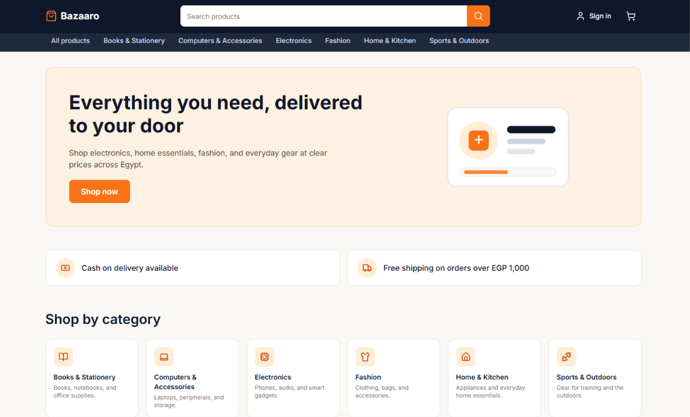 | Storefront hero, categories, and new arrivals |
| Shop | 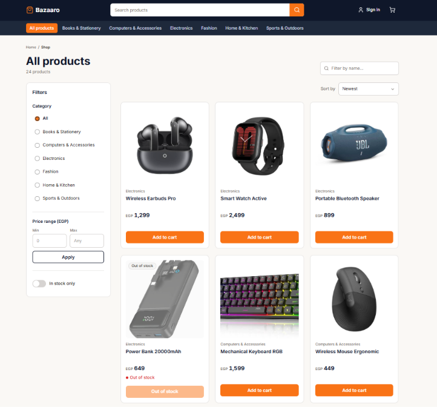 | Catalog with faceted search and sorting |
| Product | 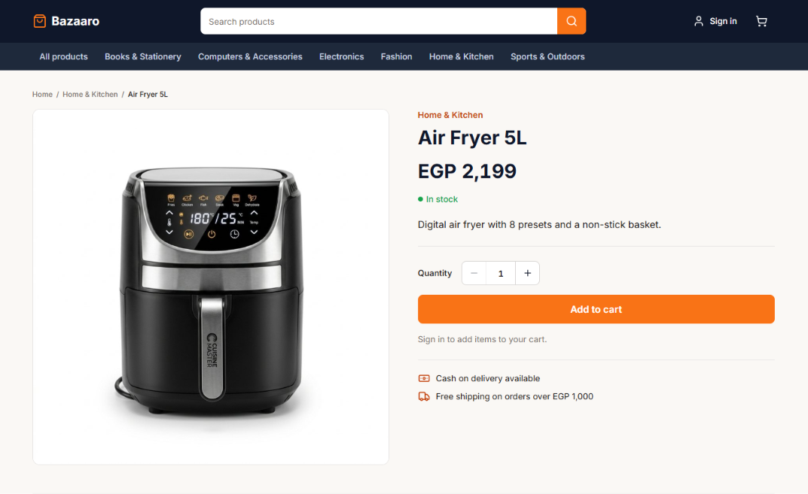 | Product details, stock status, and recommendations |
| Cart | 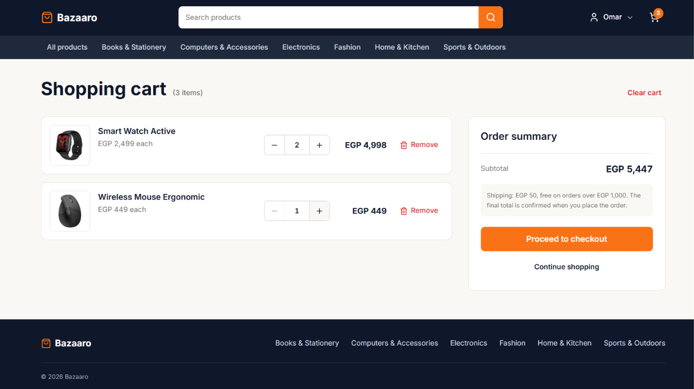 | Server-synchronized cart with quantity controls |
| Checkout | 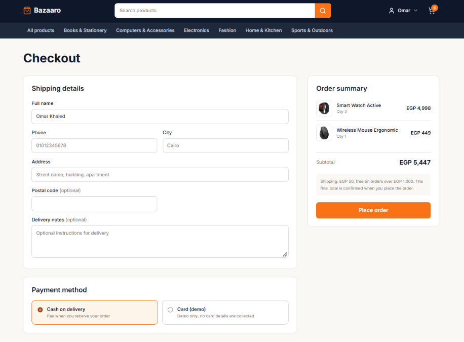 | Shipping address and payment method selection |
| Confirmation | 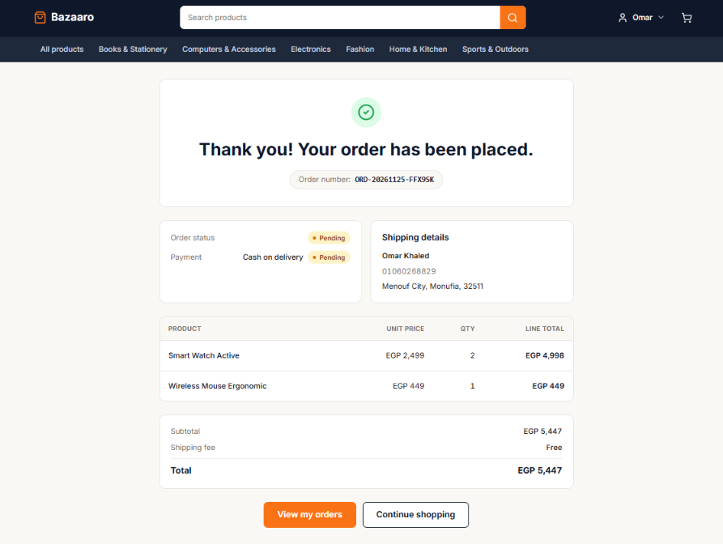 | Order summary and estimated delivery timeline |
| My Orders | 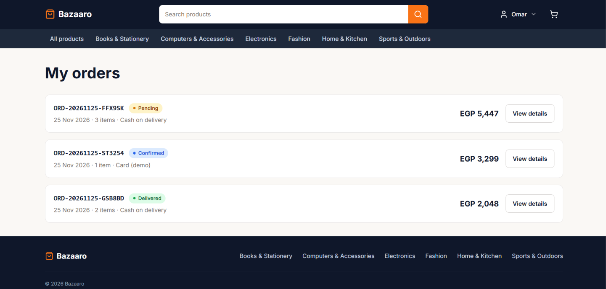 | Order history with cancellation capabilities |
| Admin Dashboard | 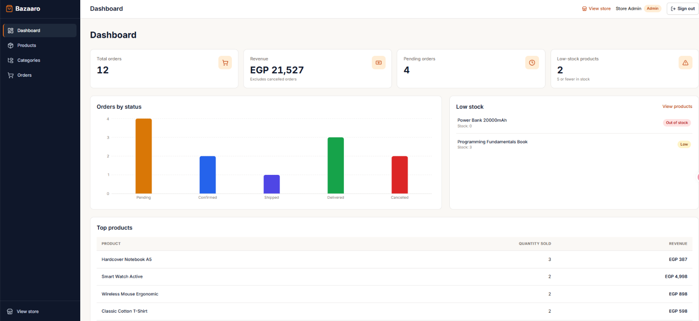 | Key metrics, revenue charts, and low-stock alerts |
| Admin Products | 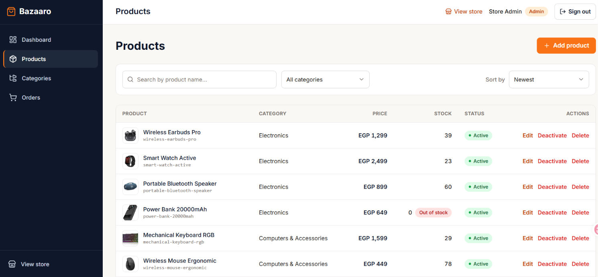 | Product catalog management and image upload |
| Admin Orders | 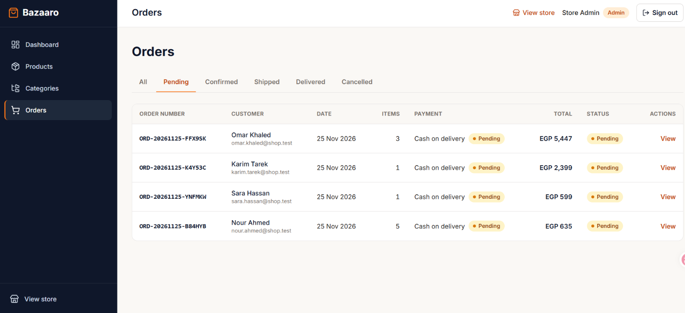 | Lifecycle order status progression table |
| Mobile Home | 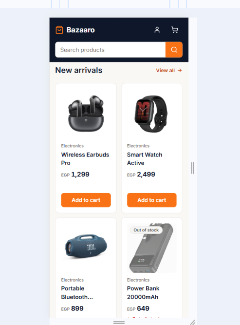 | Responsive navigation drawer and mobile home |
| Mobile Cart | 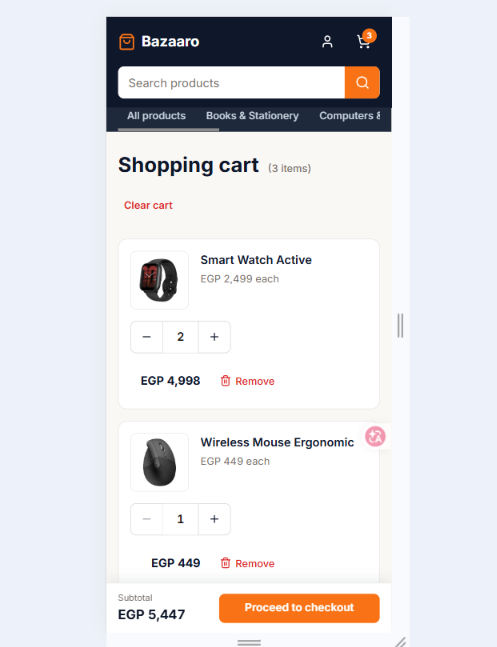 | Compact mobile cart and checkout drawer |

## Features

- **Storefront**: URL-synced search, multi-filter catalog (category, price range, stock, sort), responsive product pages, and pagination.
- **Customer area**: Server-side cart with real-time badge count, checkout (Cash on Delivery and Mock Card), and order cancellation.
- **Admin panel**: Sales dashboard with Recharts visualization, product CRUD with image uploads, category control, and order status transitions.
- **UX and accessibility**: Keyboard-navigable dialogs, toast notifications, axe-core clean audits, and client error handling.

## Tech Stack

| Layer | Technologies |
|---|---|
| Core Framework | React 19.0.1, Vite 8.3.0, React Router 7.18.5 |
| Styling & UI | Tailwind CSS 4.3.3, Lucide React 0.546.0, Recharts 3.10.1 |
| State & Networking | TanStack Query 5.107.1, Axios 1.21.1, React Hook Form 7.92.0, React Hot Toast 2.6.1 |
| Testing & Quality | Vitest 5.1.0, Testing Library 16.3.3, MSW 2.15.0, vitest-axe 0.1.0, ESLint 9 |

## Architecture

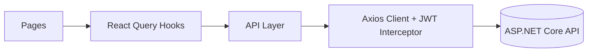

- **AuthContext**: Manages user authentication, session expiration checks, and token restoration on reload.
- **Route Guards**: `ProtectedRoute` checks session presence; `AdminRoute` restricts administrative pages to admin roles.
- **Cache Invalidation**: TanStack Query updates live cart badges and invalidates affected queries across mutations.
- **401 Handling**: Axios response interceptor clears sessions upon token expiration and redirects to `/login`.

## Routes

| Path | Access | Page |
|---|---|---|
| `/` | Public | Storefront home |
| `/shop` | Public | Filterable product catalog |
| `/products/:slug` | Public | Product details & related items |
| `/login`, `/register` | Guest | Authentication forms |
| `/cart` | Customer | Shopping cart management |
| `/checkout` | Customer | Shipping address & payment choice |
| `/order-confirmation/:id` | Customer | Post-purchase confirmation |
| `/orders`, `/orders/:id` | Customer | Customer order history & details |
| `/admin`, `/admin/orders` | Admin | Dashboard & customer orders list |
| `/admin/products`, `categories` | Admin | Product & category management |
| `/forbidden`, `*` | Public | Access denied (403) & 404 handler |

## Project Structure

```
src/
├── api/ (Axios client & endpoints)      ├── hooks/ (React Query & debounce)
├── components/ (UI primitives & layout) ├── pages/ (Storefront, cart & admin)
├── context/ (AuthContext session state) ├── routes/ (Guards & route table)
└── test/ (MSW mocks & Vitest suites)    └── utils/ (Money, errors & helpers)
```

## Getting Started

Prerequisites: Node.js >= 20. Run `npm install`, copy `.env.example` to `.env`, then `npm run dev`.

The app starts on `http://localhost:5173`. `VITE_API_URL` must include `/api` (production: `https://bazaaro.tryasp.net/api`).

| Script | Command | Description |
|---|---|---|
| `dev` | `vite` | Starts local dev server on port 5173 |
| `build` | `vite build` | Compiles production assets into `dist/` |
| `preview` | `vite preview` | Previews production build locally |
| `lint` | `eslint .` | Runs ESLint analysis across codebase |
| `test` | `vitest run` | Runs full automated test suite |

## Testing

Run tests with `npm test` or `npm run test:coverage`. All **146 automated tests pass** across 34 test suites, covering UI components, custom hooks, MSW integration flows, and automated vitest-axe accessibility audits.

## Deployment (Vercel)

- Root directory: `frontend` with Vite preset. Build: `npm run build`, output: `dist`.
- Environment variable: `VITE_API_URL` set to the production API endpoint.
- Client-side routing: `vercel.json` rewrites all requests to `/index.html`.
- Auto-deployments enabled on push to `main`.
- *Pitfalls*: `VITE_` variables are baked in at build time (redeploy on change); backend CORS must allow the Vercel origin with no trailing slash.

## Troubleshooting

| Issue | Cause | Resolution |
|---|---|---|
| Network Error on requests | Backend offline or CORS rejected | Verify `VITE_API_URL` includes `/api` and backend CORS permits the origin. |
| 401 Session Expired loop | Expired or invalid JWT token | Clear browser storage and sign in again via `/login`. |
| 404 on page refresh | Missing SPA routing rewrite | Ensure `vercel.json` with rewrite to `/index.html` is deployed. |

## Note

Product photos are sample images used for demonstration only.

## Author

Almaghraby Ali — [GitHub Profile](https://github.com/AlmaghrabyAli)
